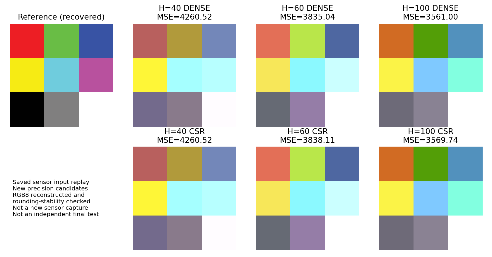

# 最新入力の新版実機再生：MSEと9色RGB

`FIRMWARE=PRECISION_SCAN_V2` のvコマンドによる実機出力を受領しました。
これは保存した9色のセンサ入力を新候補へ与えた結果で、v送信時の新たな紙の読取ではありません。

| H | Dense MSE | CSR MSE | CSRの増加率 |
| --- | ---: | ---: | ---: |
| 40 | 4260.518519 | 4260.518519 | 0.0000% |
| 60 | 3835.037037 | 3838.111111 | +0.0802% |
| 100 | 3561.000000 | 3569.740741 | +0.2455% |

MSEは小さいほど良い値です。今回の入力ではCSRによる追加悪化は5%以内ですが、
元のDenseのMSEも大きいままで、絶対的な色精度が十分になった結果ではありません。
学習済み9色の再読取なので独立した最終評価にも当たりません。
新候補の推論時間はまだ未測定で、以前の候補の時間を流用しません。

## 9色のRGB

順番は左上から右へ、上段3色→中段3色→下段3色です。

- [9色×全6条件のRGB一覧CSV](rgb9_all_conditions.csv)
- [R・G・Bを別列にしたCSV](rgb9_long.csv)
- [各色ごとのMSE（9色×6条件）](per_color_mse.csv)
- [今回のMSEと確認結果](mse_summary.csv)

| H | Dense画像 | CSR画像 |
| --- | --- | --- |
| 40 | [PNG](h40_dense.png)／[PPM](h40_dense.ppm) | [PNG](h40_csr.png)／[PPM](h40_csr.ppm) |
| 60 | [PNG](h60_dense.png)／[PPM](h60_dense.ppm) | [PNG](h60_csr.png)／[PPM](h60_csr.ppm) |
| 100 | [PNG](h100_dense.png)／[PPM](h100_dense.ppm) | [PNG](h100_csr.png)／[PPM](h100_csr.ppm) |

PPMはP3形式3×3画素、PNGは各画素を120×120へ同じRGBで拡大した360×360画素です。
参照画像は [reference_recovered.png](reference_recovered.png) です。元Notebookの表示から復元したRGBを使い、元PNGとの照合は未実施です。
全条件の見比べは [comparison.png](comparison.png)／[比較図PDF](comparison.pdf) に保存しました。

## RGB値の出典と確認

今回の実機ログにはMSEがあり、各画素RGBそのものは表示されていません。
保存入力と凍結した重みから、ファームウェアへ埋め込んだFP32参照値を再現してRGBを復元しました。
実機の最大絶対誤差は1.8e-7で、小数表示の丸めを含めた上界1.9e-7よりも、
全画素のRGB丸め境界までの距離が十分大きいことを確認しました。
したがって、復元した162成分（6画像×9色×RGB3成分）の整数値は実機の丸め結果と一致します。
6画像から再計算したMSEも、実機表示と小数6桁の丸め精度内で一致しました。

原文は [latest_replay_01.txt](../hardware/latest_replay_01.txt)、入力の出典は
[latest_replay_manifest.json](../latest_replay_manifest.json) に記録しています。
重み・閾値を今回の結果に合わせて変更していません。

