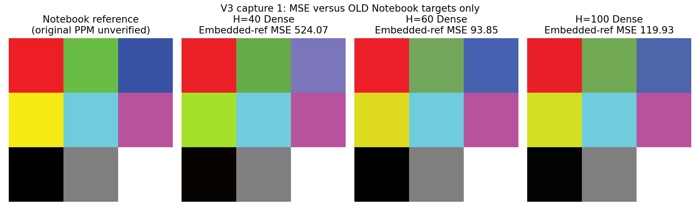

# V3・CAPTURE=1の新しい実測

新たに紙を読んだ9色の実測結果です。モデルはこの読取を受け取る前に固定したV3です。
全36学習入力でのMSEや、過去入力を再生したMSEとは分けて扱います。

**訂正：下表はプログラム内の復元9色とのMSEです。**
その後提供された正解result.ppmとの相違を確認し、300以下の達成判定を撤回しています。
提供HTMLの計算式と再現結果は [reference_audit](../../reference_audit/README.md) にあります。

| H | 復元9色とのMSE | 提供result.ppmとのMSE | PPM | PNG |
| --- | ---: | --- | --- | --- |
| 40 | 524.074074 | 3984.00 | [PPM](h40_dense.ppm) | [PNG](h40_dense.png) |
| 60 | 93.851852 | 3442.59 | [PPM](h60_dense.ppm) | [PNG](h60_dense.png) |
| 100 | 119.925926 | 3522.89 | [PPM](h100_dense.ppm) | [PNG](h100_dense.png) |



[9色のRGB一覧](rgb9.csv)、[全色の誤差](patch_errors.csv)、[比較画像PDF](comparison.pdf) も保存しています。
40次元では青と黄色の色別MSEがそれぞれ2073.67、2506.00で、合計誤差の約97%を占めます。
色別MSEはその色のRGB3成分での平均、上表は全9色27成分での平均です。

元の投稿は [submitted_log.txt](submitted_log.txt) に保持し、貼り付け時の行頭・行末のバックスラッシュだけを
取り除いた [normalized_log.txt](normalized_log.txt) から解析しました。
[record_capture.py](../../record_capture.py) で、元ログのSHA256、学習データ・各重みのSHA256、
RAWからNN入力への正規化、PPMから内部の復元9色に対するMSEの再計算を確認しています。
元ログのquality_goalのYES/NOも内部の復元9色との比較で、先生の基準との一致を確かめたものではありません。
同じ重みをPCで計算したRGB8も全81成分で実機出力と一致しました。
確認結果は [summary.json](summary.json)、生データ・校正情報は [inputs.csv](inputs.csv) と元ログにあります。

この9入力はV3の学習や設定選択には使っていません。
正解を修正したV4では学習側に加えたため、V4の確認にはさらに新しい読取が必要です。
同じ学習チャートを新たに読んだ**1回**の確認であり、未見チャートの最終評価や反復平均ではありません。
測定日付は受領日の2026年11月6日として記録し、壁時計の実行時刻は不明です。
参照RGBは元Notebookの保存済み表示から復元した値で、元PNGとの数値照合は未実施です。

記録の再生成：

```sh
python3 learning_followup/record_capture.py learning_followup/physical_readings/capture_01/submitted_log.txt --received-date 2026-11-06
```
