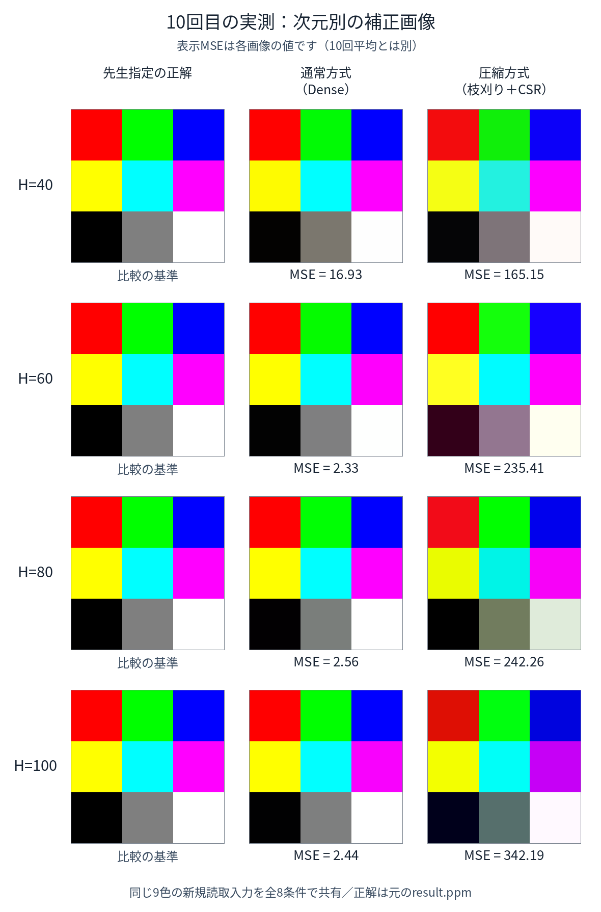

# 各次元の色画像とMSE

[最新版の案内へ戻る](../../README.md)

実際に紙を読んだ10回の出力画像です。元のPPMとPNGをそのまま複製し、色を変更していません。
4種類の次元×通常方式／枝刈り＋CSR×10回＝80枚を収録しています。

## 最後に測った10回目：8条件の比較

10回目は最後の測定回として掲載しています。最もよい回を選んだものではありません。
以下のMSEは**各画像1枚の値**で、10回平均とは異なります。
PNGは色を見る用途、PPMは先生の計算サイトで元のresult.ppmと比べる用途に使えます。

| 次元H | 通常方式（Dense） | 枝刈り＋CSR |
| --- | --- | --- |
| 40 | 16.93：[PNG](capture_10/h40_dense.png)／[PPM](capture_10/h40_dense.ppm) | 165.15：[PNG](capture_10/h40_csr.png)／[PPM](capture_10/h40_csr.ppm) |
| 60 | 2.33：[PNG](capture_10/h60_dense.png)／[PPM](capture_10/h60_dense.ppm) | 235.41：[PNG](capture_10/h60_csr.png)／[PPM](capture_10/h60_csr.ppm) |
| 80 | 2.56：[PNG](capture_10/h80_dense.png)／[PPM](capture_10/h80_dense.ppm) | 242.26：[PNG](capture_10/h80_csr.png)／[PPM](capture_10/h80_csr.ppm) |
| 100 | 2.44：[PNG](capture_10/h100_dense.png)／[PPM](capture_10/h100_dense.ppm) | 342.19：[PNG](capture_10/h100_csr.png)／[PPM](capture_10/h100_csr.ppm) |

正解は [先生指定のresult.ppm](../reference/result.ppm) です。[正解のPNG](reference.png) も用意しました。
9色のRGB・計27成分の二乗誤差を平均し、元の受領PPMから全80個を再計算して確認しました。

## 全10回の画像と、10回平均MSE

次の数値は各条件の**10回平均**です。平均値に対応する1枚の実測画像を作ったわけではありません。
画像のRGBを平均しても、各回のMSEの平均と同じ意味にはならないため、全回の画像を掲載しています。

| 次元H | Dense平均MSE | CSR平均MSE | 各回の画像とMSE |
| --- | ---: | ---: | --- |
| 40 | 319.56 | 452.04 | [全10回の画像](h40_all10.png) |
| 60 | 238.34 | 493.51 | [全10回の画像](h60_all10.png) |
| 80 | 231.68 | 465.73 | [全10回の画像](h80_all10.png) |
| 100 | 260.43 | 651.93 | [全10回の画像](h100_all10.png) |

## 1枚ずつ開く

- [1回目](capture_01)
- [2回目](capture_02)
- [3回目](capture_03)
- [4回目](capture_04)
- [5回目](capture_05)
- [6回目](capture_06)
- [7回目](capture_07)
- [8回目](capture_08)
- [9回目](capture_09)
- [10回目](capture_10)

各フォルダのh40_dense.png、h40_csr.pngなどが個別画像です。同名PPMもあります。
全画像の対応・各回MSE・元ファイルのSHA256は [images.csv](images.csv)、検算結果は [verification.json](verification.json) へ保存しています。
これは保存済みの実測結果の画像化で、新しい測定や再学習ではありません。
