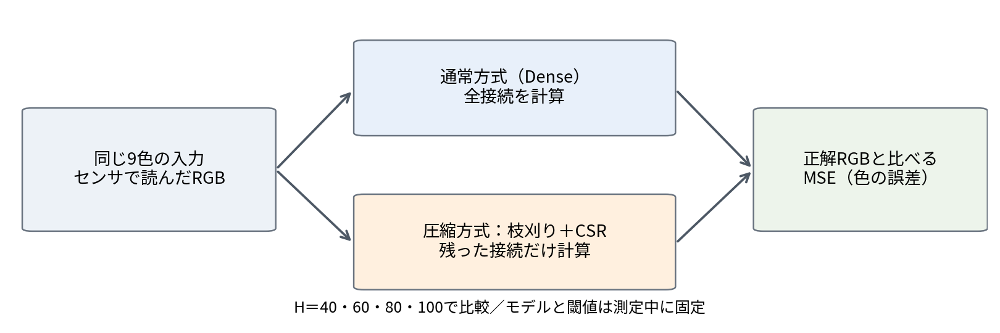
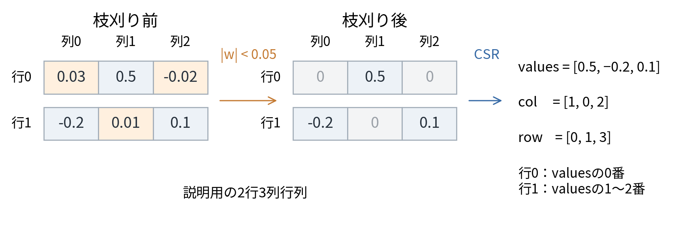

**実験の内容・式17個・使用コード・結果と考察**

完成版レポートと同じ測定値を使い，「何をしたか」「なぜそうしたか」「何が分かったか」を，自分の言葉で説明するための資料である．

各項目の最初に，そのまま声に出して練習できる説明を置いた．続く計算例やコードで，説明の根拠を確認する．

**読む順番**

- 1〜6：全体像・目的・装置・測定・学習データ
- 7〜13：入力・ネットワーク・学習の式とコード
- 14〜19：枝刈り・閾値・CSR・容量の計算
- 20〜24：MSE・統計・実際の精度とばらつき
- 25〜29：容量・速度・RAM・プログラムの確認
- 30〜32：結論・改善案・口頭質問の練習

「レポート式(番号)」は，完成版の式番号を指す．説明用に置いた数値例と，実測値は区別して記載した．MSEは小数第2位まで表示し，第3位以降を切り捨てた．

急ぐ場合は，まず1・2・23・27・28・30を読み，その後に式とコードを確認する．PDFを保存すれば，図も含めてオフラインで読める．

\newpage

# 1　最初に何と説明するか

**「色を補正するモデルを，小さく・速くしても，色の正確さを保てるか調べました．」**

Arduinoのようなマイコンは，保存容量と計算資源に制約がある．そこで，色補正ニューラルネットワークの小さい重みを0にする枝刈りと，残った重みだけを保存する圧縮行格納形式（Compressed Sparse Row：CSR）を使った．

全重みを使う密行列形式（Dense）と比較し，各隠れ層の大きさHを40・60・80・100とした．4種類×2方式で8条件となる．

9色の紙を新しく10回読み，各回の同じ入力を8条件へ与えた．色の誤差には平均二乗誤差（Mean Squared Error：MSE）を用いた．速度は保存入力の実機再生，容量は配列の計算と単独コンパイルで調べた．

**結論として，容量と計算時間は減ったが，圧縮後の精度維持は達成しなかった．** モデル配列容量は約61〜70%，推論時間は約29〜44%減った．一方，CSRの10回平均MSEは全Hで300を超えた．

最後に「小さく・速くする効果と，精度が悪化する問題の両方を確認した実験です」と結ぶ．

\newpage

# 2　何を何回行ったか

**「紙を読む回数と，計算を繰り返す回数を分けて記録しました．」**

**学習**：過去の実測135行を使用した．同じHの保存済みモデルを出発点に，各Hで40,000回追加更新した．紙を40,000回読んだものではない．

**閾値選択**：別の8×8チャート64色を2回読んだ128入力と，学習内の9入力を使った．

**新規の精度測定**：9色を読み終える操作を10回行った．新しい入力は9×10＝90組で，8条件×10回＝80個のMSEと80枚のPortable Pixmap（PPM）画像を得た．

**速度測定**：各条件で10回ウォームアップした後，100推論×5組を計時した．計時対象は1条件500推論，全8条件で4,000推論である．

**単独メモリ比較**：1条件ずつモデルを入れたプログラムを，8条件それぞれ1回コンパイルした．

センサの内部では各チャンネルを10サンプル平均した．この10サンプルと，9色の紙を読む10回の反復は別である．

\newpage

# 3　はじめにの流れを説明する

**対応：レポート1章，図1**

**「容量に制約があるので，モデルの保存量と計算量を減らす方法を採用しました．」**

問題は，モデルを大きくすると重みが増えることである．このネットワークは隠れ層を2層もち，その間だけで $H^2$ 個の重みを使う．Hを2倍にすると，この部分の重みは4倍になる．

そこで，絶対値が小さい重みを0にする．これが枝刈りである．ただし，通常の配列に0を書くだけでは，配列の長さは変わらない．

さらにCSRへ変換し，非ゼロの重みと位置だけを保存する．推論でも残った重みだけを使うことで，保存量と演算量の削減を図る．

重みを削ると色の誤差が増える可能性があるため，**容量と速度だけでなく，精度も一緒に比較した．**

{width=100%}

\begin{center}同じ入力で比較する流れ\end{center}

\newpage

# 4　何を使って色を読んだか

**対応：レポート3.1，図5**

**「赤・緑・青の光を順番に当て，紙からの反射を光センサで読みました．」**

使用ボードはArduino UNO R4 WiFiで，主マイコンはRA4M1，クロックは48 MHzである．保存用のフラッシュメモリ（Flash）は262,144 byte，RAM（Random Access Memory）は32,768 byteである．

{width=100%}

\begin{center}回路図\end{center}

使用コードでは，赤・緑・青（Red，Green，Blue：RGB）の発光ダイオード（Light Emitting Diode：LED）をD8・D6・D7で制御し，受光電圧をA0で読む．LED側の抵抗は各330 Ω，センサ側は1 kΩである．光センサの型番は未確認である．

各色の点灯後10 ms待ち，10サンプルを2 ms間隔で読んで平均した．`readRGB()`が点灯順を制御し，`readAverage()`が平均を求める．

\newpage

# 5　実際の測定手順と保存入力

**対応：レポート3.5・3.6**

**「各回で黒白校正を行い，9色を読み終えた時点を1回としました．」**

黒を当ててb，白を当ててwを送り，入力の基準を登録した．その後，赤・緑・青・黄・水色・紫・黒・灰・白の順に紙を当て直し，rを各1回送った．9色の終了後，nで次の回へ進んだ．操作はシリアル通信で行い，外付けボタンは使用していない．

**1色を読んだ時点で，その入力を全8条件へ渡した．** DenseとCSRで紙を別々に読み直すと，入力変動と方式差が混ざるためである．重みと閾値は10回の前に固定した．

生の値，黒白校正値，正規化した入力，8条件の出力画像とMSEを保存した．紙は手で支え，距離・角度・照度の数値記録は取っていない．

**保存入力の実機再生**は，以前に測った入力をArduinoのモデルへ再び与える操作である．紙を新しく読む測定ではない．同じ入力を反復できるため，速度比較に使った．

口頭では「精度は新規10回，速度は保存入力の反復再生です」と分けて説明する．

\newpage

# 6　学習データと正解は何か

**対応：レポート3.2・3.7，付録**

**「入力はセンサの実測値，正解はその色に対応するRGBです．」**

最終学習には135行を使った．内訳は3×3チャート111行と6×4チャート24行で，同じ色の繰り返しも含む．135種類の異なる色を測った意味ではない．

3×3の教師値と評価には先生指定の`result.ppm`を使用した．灰色の正解は(127,127,127)である．6×4の24行は，配布Notebookの教師値を使用した．

{width=33mm}

\begin{center}result.ppmの9色\end{center}

学習用の入力で重みを更新し，検証用の入力で枝刈りの閾値を選んだ．新規10回の入力は，その学習・閾値選択に加えていない．

ただし，新規測定も学習と同じ9色の紙である．**新しく読み直す能力は調べたが，未知の色に対する性能までは確認していない．**

\newpage

# 7　黒白正規化の式を読む

**対応：レポート式(1)，normalizeInput()**

**「黒を0，白を1とする共通の尺度へ直しました．」**

$$x_c=\operatorname{clip}_{[0,1]}
\left(\frac{v_c-v_{B,c}}{v_{W,c}-v_{B,c}}\right)$$

$c$はRGBのいずれか，$v_c$は生の読取値，$v_{B,c}$は黒，$v_{W,c}$は白の校正値である．分子で黒の分を引き，分母で黒から白までの幅を割る．

第1回の赤成分では，実測値から，

$$\frac{137.5-9.8}{186.4-9.8}\approx0.7231$$

となった．コードの中心部分は次である．

```cpp
float range = whiteValue - blackValue;
float result =
  (value - blackValue) / range;
```

`range`が0以下なら0を返し，最後に0未満を0，1を超えた値を1へ収める．これがクリップである．異なる生の値でも同じ0へクリップされると，その差はモデルの入力から失われる．

\newpage

# 8　重み・バイアス・ReLUとは

**対応：レポート式(2)・(4)，図2**

**「入力を重みで調整して足し，バイアスで全体をずらします．」**

$$z=w_Rx_R+w_Gx_G+w_Bx_B+b$$

重み $w$ は，入力を何倍して使うかを決める係数である．バイアス $b$ は，その合計へ加える調整値である．これらを学習で更新する．

説明用に入力(0.7,0.2,0.1)，重み(0.5,−0.2,0.3)，バイアス0.01なら，

$$z=0.35-0.04+0.03+0.01=0.35$$

となる．負の重みは入力の影響を差し引く．

隠れ層ではRectified Linear Unit（ReLU）を適用する．

$$\operatorname{ReLU}(z)=\max(0,z)$$

0.35はそのまま，−0.2は0になる．この非線形処理を挟むことで，線形変換だけでは表せない関係を学習できる．出力層ではReLUを使わず，RGB変換の直前に0〜1へクリップする．

\newpage

# 9　3−H−H−3とDenseのコード

**対応：レポート式(3)，図2**

**「RGBの3入力から，H個の隠れ層を2回通り，RGBの3出力を得ます．」**

$$\begin{aligned}
\boldsymbol h_1&=\operatorname{ReLU}(W_1\boldsymbol x+\boldsymbol b_1),\\
\boldsymbol h_2&=\operatorname{ReLU}(W_2\boldsymbol h_1+\boldsymbol b_2),\\
\boldsymbol y&=W_3\boldsymbol h_2+\boldsymbol b_3
\end{aligned}$$

重み行列の大きさは順にH×3，H×H，3×Hである．H60はRGBが60成分になる意味ではなく，**各隠れ層に計算単位が60個ある**という意味である．

Denseの最初の層では，次のように計算する．

```cpp
float value=m.b1[r];
for(int c=0;c<3;c++) value+=m.w1[r*3+c]*input[c];
layer1[r]=value>0.0f?value:0.0f;
```

`r`は出力先の単位，`c`はRGBの成分番号．`r*3+c`は重み行列を1本の配列へ並べた位置である．`+=`で積を加算し，最後の条件式でReLUを行う．

両方式とも32ビット単精度浮動小数点形式（32-bit Floating Point：FP32）で，値1個は4 byteである．整数への量子化は行っていない．

\newpage

# 10　どうやって重みを学習したか

**対応：レポート2.1・3.2，図3**

**「正解との違いを損失にし，それが減る方向へ重みとバイアスを更新しました．」**

学習はPC（Personal Computer）側で行い，Arduinoでは学習済みの数値を使って推論した．各Hは同じHのV9重みを読み込み，40,000回追加更新した．乱数シードは42である．

```python
optimizer.zero_grad(); prediction=model(ax)
# この間に次ページの損失を計算する
assert torch.isfinite(loss)
loss.backward(); optimizer.step(); schedule.step()
```

`zero_grad()`は前回の勾配を消し，`model(ax)`は入力から予測を求める．その後，次ページの式で`loss`を求める．

`backward()`は，各重みを少し変えると損失がどちらへ変わるかを計算する．この情報が勾配である．`step()`はAdam（Adaptive Moment Estimation）で実際の数値を更新する．

学習率は更新の大きさを調整する．コサイン状に0.0005から0.000005へ下げた．最初は比較的大きく動かし，後半は小さく調整する設定である．

**40,000回は最終V10の追加更新回数であり，モデルの全履歴を最初から学習した総回数ではない．**

\newpage

# 11　学習損失の式全体を読む

**対応：レポート式(5)**

**「色の間違いの点数と，大きな重みへの罰則を足した式です．」**

$$E_i=\frac13\sum_{c\in\{R,G,B\}}
\rho_\beta(\widehat y_{i,c}-t_{i,c})$$

$$\mathcal L=
\frac{\sum_{i=1}^{M}a_iE_i}{\sum_{i=1}^{M}a_i}
+10^{-6}\sum_{\ell=1}^{3}\sum_{j,k}|(W_\ell)_{jk}|$$

$M=135$は学習行数，$\widehat y$は予測，$t$は正解である．RGBの3成分を平均して1行分の点数 $E_i$ を作る．学習時のRGB尺度は0〜1である．

前半は，重要度を掛けた点数の合計を，重要度の合計で割る．前に「1／重要度の合計」を掛ける書き方と同じで，1は割り算のための係数，$a_i$は各行の点数へ掛ける係数である．

後半は3層の重みの絶対値を足したL1正則化である．バイアスは対象に含めない．例えば重みが0.1，−0.2，0なら，絶対値の合計は0.3となる．

**行の重要度 $a_i$ と，ネットワークの接続の重み $W$ は別物である．** L1は小さい重みを作る方向に作用し，実際に0へするのは後の枝刈りである．

\newpage

# 12　Smooth L1を使った理由

**対応：レポート式(6)，学習コード**

**「大きな残差に引っ張られすぎないよう，誤差の点数の増え方を変えました．」**

$$\rho_\beta(e)=
\begin{cases}
e^2/(2\beta)&(|e|<\beta),\\
|e|-\beta/2&(|e|\geq\beta)
\end{cases}
\qquad\beta=0.05$$

$e$は予測−正解である．条件に合う片方だけを使う．小さい誤差は二乗，大きい誤差は直線的に損失を増やす．

説明用に，$e=0.02$なら $0.02^2/0.1=0.004$，$e=0.1$なら $0.1-0.025=0.075$ となる．

```python
loss_rows = F.smooth_l1_loss(
    prediction, ty,
    beta=.05, reduction='none'
).mean(1)
```

`reduction='none'`で成分別に残し，`.mean(1)`でRGBを平均する．次に行重要度とL1項を使う．

```python
loss=(loss_rows*weights).sum()/weights.sum()+1e-6*sum(p.abs().sum() for name,p in model.named_parameters() if 'weight' in name)
```

`weights`は行重要度，`p`は学習パラメータである．名前に`weight`を含むものだけをL1項へ足し，バイアスを除く．

**Smooth L1は学習の点数，MSEは評価の指標である．** 損失の減少と，MSE300以下は同じ条件ではない．

\newpage

# 13　重要度とデータ拡張の意味

**対応：レポート3.2・3.7，data_weights.py**

**「同じ色の重複数を調整し，読取値の変動も学習に加えました．」**

3×3の行重要度は，色ごとの寄与をそろえ，さらに校正グループと同一グループ内の重複数で分けた．一部の行数が多いだけで，その色が極端に強く影響するのを避ける設定である．

古い読取群には，近い入力5件の教師値との整合度も反映した．整合度の係数には下限0.1を置き，全135行を正の重要度で残した．詳細な値は学習重要度CSVに保存した．

説明用に，行の点数2と4，重要度1と3なら，

$$\frac{1\times2+3\times4}{1+3}=3.5$$

となる．

データ拡張では，3×3入力の50%にRGB別のgain 0.75〜1.30とoffsetを加えた．灰・白は30%の確率で共通gain 0.5〜1.15も適用した．offset幅は，異なる教師値をもつ学習入力間の距離から決めた．

gainは掛け算，offsetは足し算の調整である．**学習中の変換なので，物理測定の回数は増えない．** 新規10回の入力は拡張や重要度の計算にも使用していない．

\newpage

# 14　何を枝刈りしたか

**対応：レポート式(7)，図4**

**「学習後に，絶対値が閾値より小さい接続の重みを0にしました．」**

$$w^{(\tau)}=
\begin{cases}
0&(|w|<\tau),\\
w&(|w|\geq\tau)
\end{cases}$$

$\tau$はどこまで削るかを決める閾値である．正負ではなく絶対値で判定する．バイアスは削らない．

{width=100%}

\begin{center}枝刈りとCSRの説明例\end{center}

H60の採用閾値は約0.05434179である．説明用に0.03，−0.02は0となり，0.2は残る．重みを削ると，途中の計算値やReLUの結果も変わり，最終的なRGBへ影響する．

閾値を大きくするほど一般に多くの重みを削れるが，精度も変わる．**このV10では，枝刈り後の再学習は行っていない．** 再学習は今後の改善案である．

Smooth L1の $\beta$ は損失の切替値，枝刈りの $\tau$ は削除判定値であり，用途が異なる．

\newpage

# 15　閾値は何を基準に選んだか

**対応：レポート3.4の表**

**「新規10回を始める前に，検証入力で条件を満たす最小容量の候補を選びました．」**

候補は学習済み重みの絶対値を並べ，隣接する異なる値の中間から作った．候補数は固定していない．次の3条件を満たす候補から選んだ．

1. 検証128入力でDenseに対するMSE増加5%以下
2. CSR配列容量がDenseより小さい
3. 学習内V8の9入力でMSE300以下

| H | 検証Dense | 検証CSR |
| --- | ---: | ---: |
| 40 | 5012.20 | 4715.84 |
| 60 | 5226.80 | 5292.58 |
| 80 | 5135.43 | 4553.44 |
| 100 | 5237.21 | 4632.38 |

**この表は最終の新規10回とは入力が違う．** 8×8の別チャートなので，MSEが約5,000でも新規9色の平均値とは矛盾しない．

検証2回目は異なる6色が同じ(0,0,0)入力になっていた．同じ入力から異なる色を出し分けることはできず，選択の信頼性には制約がある．検証1回目も誤差が大きく，入力衝突だけが原因とは断定できない．選択は暫定として扱った．

\newpage

# 16　CSRの3配列を例で説明する

**対応：レポート2.2，図4**

**「残った値と列番号を並べ，rowで行の区切りを示します．」**

以下は説明用の2行3列の行列である．番号は0から数える．

```text
        列0   列1  列2
行0      0    0.5   0
行1    -0.2    0   0.1

values = [0.5, -0.2, 0.1]
col    = [1,    0,   2  ]
row    = [0,    1,   3  ]
```

`values[k]`が重み，`col[k]`が元の列番号である．行rでは`row[r]`から`row[r+1]`の手前までを読む．

行0はk＝0だけ，行1はk＝1，2を使う．最後の3は終端であり，`values[3]`を読む指定ではない．rowの個数は行数＋1になる．

入力(1,2,3)，バイアス0なら，行0は $0.5\times2=1$，行1は $-0.2\times1+0.1\times3=0.1$ となる．

**CSRは枝刈り後の行列の表現を変える処理である．** 正しく変換すれば，削った後の通常行列と同じ計算ができる．

\newpage

# 17　CSR推論コードを説明する

**対応：レポート3.3，付録のコード**

**「各行について，残った重みだけの積を足します．」**

実際の`sparseLayer()`の本体を，改行と説明コメントを付けて示す．

```cpp
// 出力の各行を順番に計算する
for (int r=0; r<layer.rows; r++) {
  // バイアスから始める
  float value=layer.bias[r];
  // この行の非ゼロ重みだけを使う
  for (uint16_t k=layer.row[r];
       k<layer.row[r+1]; k++)
    value += layer.values[k]
           * input[layer.col[k]];
  // 隠れ層だけReLUを使う
  output[r]=(relu && value<0)
          ? 0 : value;
}
```

`r`は出力の番号，`k`は圧縮した配列内の番号である．`col[k]`で掛ける入力を探すため，**kと元の列番号は同じとは限らない．**

`predict()`はこの層計算を3回呼び，隠れ層2つでは`relu=true`，出力層では`false`とする．0を掛ける計算は省けるが，位置情報を読む処理は追加される．

\newpage

# 18　NNZとDenseの容量を計算する

**対応：レポート式(8)・(9)，表3**

**「接続数とバイアス数を数え，1個4 byteを掛けました．」**

非ゼロ要素数（Number of Nonzeros：NNZ）は，今回は3層に残った重みの総数Kである．バイアスはNNZに数えない．

元の重み数とバイアス数は，

$$N_w=3H+H^2+3H=H^2+6H$$
$$N_b=H+H+3=2H+3$$

なので，FP32のDense配列容量は，

$$B_{\mathrm{Dense}}=4(H^2+8H+3)$$

となる．H60なら重み3,960個，バイアス123個で，$(3,960+123)\times4=16,332$ byteである．

式(8)の疎性Sは，0になった重みの割合である．

$$S=1-\frac{K}{H^2+6H}$$

H60ではK＝1,141なので，重みの約71.19%が0となる．この割合は，位置情報やバイアスも含めた配列容量の削減率とは異なる．

\newpage

# 19　CSRの容量と成立条件を計算する

**対応：レポート式(10)・(11)・(12)**

**「値の容量に，列・行の位置情報とバイアスを足します．」**

$$\begin{aligned}
B_{\mathrm{CSR}}
&=4K+K+2(2H+6)+4(2H+3)\\
&=5K+12H+24
\end{aligned}$$

`values`はFP32で4K byte，`col`は8ビット整数でK byte，`row`は16ビット整数で1個2 byteである．バイアスはFP32のまま全て残す．

行位置の個数は，層ごとに行数＋1なので，$(H+1)+(H+1)+(3+1)=2H+6$ となる．

H60では，4,564＋1,141＋252＋492＝**6,449 byte**．Denseの16,332 byteから60.51%削減した．

小さくなる条件は $B_{\mathrm{CSR}}<B_{\mathrm{Dense}}$ を整理して，

$$5K<4H^2+20H-12$$

となる．位置情報にも容量が必要なので，ほとんど重みを削れない場合にはCSRが小さくならない．本実装の列番号は8ビット，行位置は16ビットなので，大きなHへ拡張する際は型の上限も確認する．

\newpage

# 20　出力とMSEをどう計算したか

**対応：レポート式(13)，outputTo255()**

**「出力を整数RGBにし，正解との差を二乗して27成分で平均しました．」**

モデル出力を0〜1へクリップし，255倍して0.5を加え，整数へ変換する．非負値をこの方法で四捨五入する．

$$\mathrm{MSE}=\frac1{27}
\sum_{i=1}^{9}\sum_{c\in\{R,G,B\}}(y_{i,c}-t_{i,c})^2$$

9色×3成分なので27で割る．符号を消すため二乗し，大きく外れた成分ほど強く反映する．小さいほど正解に近く，0なら27成分全てが一致する．

説明用に1色だけが正解(255,0,0)，予測(245,10,5)で，他の8色が一致した場合，MSEは $(100+100+25)/27=8.33\ldots$ である．

保存入力版の実コードの計算部分を示す．

```cpp
int e=static_cast<int>(
  pixels[model][point][c])
  -trained_models::REFERENCE_RGB[point][c];
mse[model]+=static_cast<double>(e)*e/27.0;
```

RGBへ変換する四捨五入と，MSE表示の小数第3位以降の切り捨ては別の処理である．MSE300は「RGBが300ずれた」意味ではなく，差の二乗の平均である．

\newpage

# 21　平均と標本SDの意味

**対応：レポート式(14)，表1**

**「平均で誤差の大きさ，SDで読取ごとのばらつきを見ました．」**

各回のMSEを $m_r$ とすると，

$$\overline m=\frac{m_1+\cdots+m_{10}}{10}$$

である．今回は全回9色なので，各回MSEの平均は，90色270成分の二乗誤差をまとめて平均した値とも一致する．平均した画像からMSEを計算したものではない．

標本標準偏差（Standard Deviation：SD）は，

$$s_m=\sqrt{\frac1{9}
\sum_{r=1}^{10}(m_r-\overline m)^2}$$

である．各回が平均から離れた量を二乗して足し，標本SDの定義に従い10−1＝9で割り，平方根を取る．SDが大きいほど回ごとの違いが大きい．

H60 Denseは平均238.33，標本SD738.23だった．良い回が多くても，1回の大きな誤差が平均とSDへ強く影響する．

このSDは読取10回のばらつきである．速度表の±は100推論×5組のばらつきで，観測単位が異なる．

\newpage

# 22　方式差と増加率の式を読む

**対応：レポート式(15)・(16)・(17)，表2**

**「同じ回の差と，10回平均の比を使って比較しました．」**

$$d_r=m_{r,\mathrm{CSR}}-m_{r,\mathrm{Dense}}$$

正ならCSRの誤差が増え，負なら減ったことを示す．同じ入力同士で引くため，方式による違いを比較できる．

平均MSEの増加率は，

$$R_{\mathrm{MSE}}=
100\left(\frac{\overline m_{\mathrm{CSR}}}
{\overline m_{\mathrm{Dense}}}-1\right)$$

である．H60では238.33→493.51，増加率は107.06%となる．各回の増加率10個を平均した値ではない．

容量と時間は，減った割合を求めるので，

$$\begin{aligned}
R_B&=100\left(1-\frac{B_{\mathrm{CSR}}}{B_{\mathrm{Dense}}}\right),\\
R_T&=100\left(1-\frac{T_{\mathrm{CSR}}}{T_{\mathrm{Dense}}}\right)
\end{aligned}$$

とする．MSE増加率は正なら悪化，削減率は正なら改善を示す．切り捨て前の値から計算した．

\newpage

# 23　精度の結果を数字で説明する

**対応：レポート4.1，表1・2**

**「Denseは3条件で平均300以下でしたが，CSRは全条件で平均300を超えました．」**

| H | Dense平均MSE | CSR平均MSE |
| --- | ---: | ---: |
| 40 | 319.56 | 452.04 |
| 60 | 238.33 | 493.51 |
| 80 | 231.68 | 465.72 |
| 100 | 260.42 | 651.92 |

| H | Denseの300以下 | CSRの300以下 |
| --- | ---: | ---: |
| 40 | 9/10 | 9/10 |
| 60 | 9/10 | 9/10 |
| 80 | 9/10 | 8/10 |
| 100 | 8/10 | 0/10 |

Denseの平均が最小だったのはH80である．ただし，Hを大きくすれば単調に改善したわけではない．

全H・全10回で，CSRのMSEが同じ回のDenseを上回った．平均MSEの増加率は41.46〜150.33%で，**精度維持の条件「増加5%以下」は達成しなかった．**

「300以下の回が9回ある」と「10回平均が300以下」は別である．H40では9回が300以下でも，高誤差の回を含む平均は319.56となった．

\newpage

# 24　第2回と画像・グラフの読み方

**対応：レポート4.1・5.1，図6，付録**

**「第2回は全条件で誤差が大きく，操作ミスの申告がなかったため，そのまま集計しました．」**

\begin{center}
\begin{tabular}{cc}
\includegraphics[width=37mm]{../color_images/capture_01/h60_dense.png}&
\includegraphics[width=37mm]{../color_images/capture_02/h60_dense.png}\\
第1回のH60 Dense&第2回のH60 Dense
\end{tabular}
\end{center}

第1回のMSEは2.66，第2回は2339.37である．同じモデルでも，入力が変わると色が大きく変わることが分かる．この10回平均が238.33である．

青・水色のRAWや正規化入力も他の回と異なっていた．校正・紙の位置・照射・センサ応答が原因候補だが，原因を分離して測っていないため，特定はできない．

図6の横軸は読取回，縦軸はMSEの対数目盛である．同じ縦幅は同じ差ではなく同じ倍率を表す．破線は300，線で結んでいても連続時間の変化ではなく各回の結果である．

**画像1枚のMSEはその回の値であり，10回平均を代表する画像ではない．**

\newpage

# 25　配列容量はどれだけ減ったか

**対応：レポート4.2，表3，図7の容量側**

**「索引とバイアスも含めて，モデル配列が約61〜70%小さくなりました．」**

| H | Dense byte | CSR byte |
| --- | ---: | ---: |
| 40 | 7,692 | 2,854 |
| 60 | 16,332 | 6,449 |
| 80 | 28,172 | 9,229 |
| 100 | 43,212 | 13,094 |

H60では16,332→6,449 byteで60.51%削減した．残した重みは3,960個中1,141個である．位置情報の分も含めて小さくなっている．

最小容量はH40 CSRの2,854 byteである．最大削減率はH100の69.70%である．**最も小さいモデルと，削減率が最大のモデルは同じではない．**

ここで数えているのは，重み・バイアス・CSR索引の数値配列だけである．プログラムの命令やArduinoの共通処理は含まない．それらを含むFlash全体は28で別に説明する．

Denseは $H^2$ の項をもつので，Hが増えると保存量が大きくなりやすい．CSRは残った重み数Kに依存するため，Hだけで容量を決めることはできない．

\newpage

# 26　速度計測コードを説明する

**対応：レポート3.6，付録のコード**

**「100回分の経過時間を測り，100で割って1推論の時間にしました．」**

`timeModel()`の計時部分を，改行とコメントを付けて示す．

```cpp
float output[3]; checksum=0;
// 開始時刻
uint32_t begin=static_cast<uint32_t>(micros());
for (int call=0; call<100; call++) {
  // 保存済み9入力から選ぶ
  int input=(group*100+call)
    % comparison_models::BENCHMARK_INPUT_COUNT;
  comparison_models::predict(
    model,
    comparison_models::BENCHMARK_INPUTS[input],
    output);
  // 出力を使用する
  checksum+=output[0]+output[1]+output[2];
}
// 終了時刻との差
return static_cast<uint32_t>(micros())-begin;
```

`micros()`はマイクロ秒単位の時刻を返す．`%`は余りで，保存した9入力を巡回する．`checksum`へ出力を足し，計算結果を実際に利用している．

計時には入力選択・推論・出力合計を含む．センサ読取・シリアル表示・MSE計算は含めない．このコードが返すのは100回の合計時間である．

\newpage

# 27　速度の結果と短縮の理由

**対応：レポート4.3・5.1，表4，図7**

**「全Hで速くなりましたが，掛け算が減った割合ほど時間は減りませんでした．」**

| H | Dense µs | CSR µs | 短縮率 |
| --- | ---: | ---: | ---: |
| 40 | 465.262 | 305.834 | 34.27% |
| 60 | 945.648 | 671.674 | 28.97% |
| 80 | 1593.368 | 956.212 | 39.99% |
| 100 | 2408.160 | 1348.392 | 44.01% |

H60は945.648→671.674 µsで28.97%短縮した．H100は44.01%短縮したが，最短の絶対時間はH40 CSRの305.834 µsである．

H60では，重みと入力を掛ける回数が3,960→1,141回となり71.19%減った．ただし，CSRでは列・行の位置情報を読み，ループを制御する処理も必要になる．そのため，掛け算の削減率と時間短縮率は一致しない．各処理の内訳時間は測っていない．

最初に各条件10推論をウォームアップし，100推論×5組の平均を求めた．Dense先行とCSR先行を交互にし，順番が一方へ偏らないようにした．

図7の時間側の誤差棒は，**5組の平均時間の標本SD**であり，500推論それぞれのSDではない．紙を移動する時間も含まない．

\newpage

# 28　FlashとRAMはどうなったか

**対応：レポート4.4，表5・6，図8**

**「単独モデルのFlashは減りましたが，静的RAMは全8条件で同じでした．」**

| H | Dense Flash | CSR Flash |
| --- | ---: | ---: |
| 40 | 60,852 | 56,020 |
| 60 | 69,492 | 59,612 |
| 80 | 81,348 | 62,396 |
| 100 | 96,388 | 66,260 |

単位はbyte．H60は14.22%，H100は31.26%減少した．Arduinoの共通処理も残るので，モデル配列だけの削減率より小さい．

単独比較の静的RAMは全8条件で**6,764 byte**，静的割当後の残りは26,004 byteだった．`const`のモデル配列容量と，静的RAM表示は同じものではない．正確な配置を調べるリンカマップは保存していない．

中間計算には`float[100]`を2本使い，宣言上は800 byteである．関数内のこの配列は静的RAM表示に含まれない．**最大スタック量は未測定なので，残り26,004 byteを実際に使ったとは言えない．**

全8条件入りの新規読取版はFlash191,320／静的RAM7,324 byte，速度版は187,888／6,740 byteだった．単独モデル版とは機能と搭載数が異なる．

\newpage

# 29　コードと計算の確認方法

**対応：レポート3.3・4.4，付録**

**「索引・固定入力・実測出力・MSEを，それぞれ照合しました．」**

`validIndices()`はrowの開始・終端・単調性，colの範囲と順序を調べる．`selfCheckAll()`は固定12入力に対する全8条件の出力を，PCで作った参照値と比較する．

**CSRの正しさは，枝刈り後の通常行列と比べる．** 元のDenseとの出力差は，重みを削った影響も含むため，それだけでCSR変換の不具合とは判定しない．

新規10回の全80PPM，計2,160成分は，保存した入力を固定V10へ通したPC再計算と一致した．MSE80個は先生の計算サイトの方法とも表示桁の範囲で一致した．これは実装・集計の一致であり，精度が高いという意味ではない．

**使ったファイルの流れ**

PC側の学習・変換・集計に使った主なファイルを示す．Arduinoでは`predict()`で推論する．

```text
train.py                      学習
select_compression.py         閾値候補の比較
finalize_compression.py       閾値の固定
build_program.py              数値ヘッダへ出力
record_fresh_capture.py       読取ログの検算
record_single_model_memory.py 単独表示の記録
```

\newpage

# 30　おわりにをどう説明するか

**対応：レポート3.7・5章**

**「容量と速度の改善は確認しましたが，精度維持との両立はできませんでした．」**

モデル配列は60.51〜69.70%，推論時間は28.97〜44.01%，単独Flashは7.94〜31.26%減った．静的RAMは変わらなかった．一方，CSRの平均MSE300以下と，Denseからの増加5%以下は全Hで達成しなかった．

当初から変えた点は，学習データを33組から135行へ増やしたこと，入力変動へ対応するデータ拡張と重み付きSmooth L1を使ったこと，H80・100を追加したことである．

新規10回は同じチャートの再読取である．H50，未知色の独立最終評価，搭載できる最大H，最大スタック量は未実施である．H間では初期重みも異なり，Hだけの効果を断定できない．

改善するなら，**まず閾値を下げる，層ごとに選ぶ，削った接続を0に固定して再学習する**方法を検討する．次に入力・校正の再現性を調べ，設定を固定して別チャートで評価する．

中間配列をHに合わせれば宣言上800 byteから8H byteにできるが，未実装である．改善案と，今回実際に行った処理は分けて話す．

\newpage

# 31　よくある質問：結果と測定

**Q．結局，成功したのか．**

容量・速度の削減は成功した．精度維持を同時に満たす目標は未達成だった．目的の一部を確認し，残る課題も測定できたと説明する．

**Q．MSEが低い1回だけ出せばよいのか．**

10回で評価すると決めたので，全回を使う．第2回も操作ミスと確認できておらず，除外していない．良い1枚のMSEと全10回平均は別に示す．

**Q．検証では5%以内なのに，新規測定で悪化した理由は．**

選択に使った入力と新規入力は異なる．検証入力の衝突や読取状態の変動もあり，選んだ閾値の精度が別の入力で維持されなかった．支配的な原因は特定していない．

**Q．学習135行のMSEも高いのはなぜ．**

付録の値は全行を同じ重要度で評価した整数RGBのMSEである．学習は重要度付きSmooth L1とL1を使うので，最適化している量が異なる．過去の変動した入力も含み，全行への完全一致は達成していない．

**Q．どのHが一番良いのか．**

Denseの平均MSEはH80，CSRの最小容量・最短時間はH40だった．今回，精度維持と削減を両立した組はなく，1条件を総合的な成功と断定しない．

\newpage

# 32　よくある質問：式とコード

**Q．元の重みはどう求めたのか．**

正解と予測から損失を計算し，逆伝播で勾配を求め，Adamで更新した．最終V10は，同じHのV9重みから追加学習した．枝刈りは，その学習後に行う．

**Q．枝刈りとCSRは何が違うのか．**

枝刈りは小さい重みを0にする操作，CSRは0を保存しない表現方法である．精度への影響を生む重みの変更と，格納方式の変更を分けて考える．

**Q．rowの最後や，内側ループの上限はなぜ必要か．**

最後の行の終端まで分かるよう，rowは行数＋1個を持つ．`k < row[r+1]`とすることで，次の行の最初の重みを混ぜずに計算できる．

**Q．なぜMSEの計算は27で割るのか．**

9色のRGB各3成分，計27個の二乗誤差を平均するためである．学習式ではRGB平均の3と，行重要度の合計での平均が使われる．

**Q．参考文献は何の根拠か．**

レポートの[1]はL1正則化，[2]は枝刈り，[3]は疎行列計算，[4]は`micros()`，[5]はSmooth L1の根拠である．論文の方法全体をそのまま実装した意味ではなく，実際の条件は実験方法とコードに記載した．
