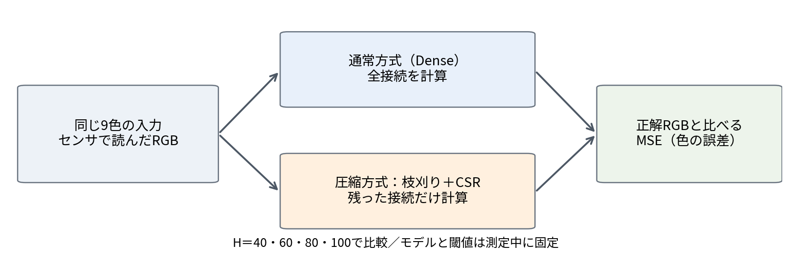
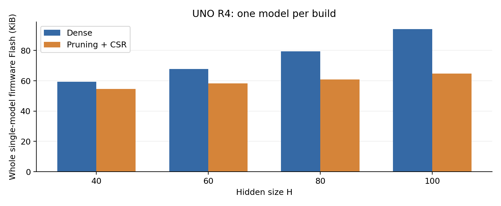

# 概要

色補正ニューラルネットワークに枝刈りとCSRを適用し，Denseと容量・推論時間・MSEを比較した．隠れ層の大きさHを40・60・80・100とし，9色のチャートを10回読み取った．各回の同じ入力を全8条件へ与えた．

モデル配列容量は60.51〜69.70%，固定入力による実機推論時間は28.97〜44.01%，単独モデル入りプログラムのFlashは7.94〜31.26%減少した．静的RAMは全8条件で6,764 byteだった．一方，10回平均MSEはDenseが231.68〜319.56，枝刈り＋CSRが452.04〜651.93となり，容量・速度の改善と精度維持の両立は達成しなかった．

# 目的

Arduino上の色補正モデルについて，枝刈り＋CSRによる保存容量と推論時間の削減効果，および補正精度への影響を調べる．Denseに対するMSE増加5%以下を精度維持の条件とし，MSE300以下も別に判定する．

同じHのDenseと枝刈り＋CSRへ同一入力を与えて比較した．当初計画の40・50・60次元から，実施条件を40・60・80・100へ変更した．H50は未実施である．

# 比較の構成

図1のように，1回のセンサ読取から得たRGBを両方式へ入力した．4種類のHと2方式を組み合わせ，比較条件は8個とした．

\Needspace{14\baselineskip}

```{=latex}
\noindent\begin{minipage}{\linewidth}
```



図1　同一入力による比較．

```{=latex}
\end{minipage}
```

| 用途 | データ・操作 |
| --- | --- |
| 学習 | 過去の実測135行：3×3チャート111行，6×4チャート24行 |
| 閾値選択 | 別の8×8チャートを2回読んだ128入力と，学習内9入力 |
| 精度測定 | 学習にも使用した3×3チャートを新しく10回読取，計90入力 |
| 速度測定 | 保存済み実測9入力を実機で反復再生 |
| メモリ比較 | 各モデル単独の8条件をコンパイル |

新規10回の入力は学習・閾値選択へ加えていない．ただし，色自体は学習時と同じであり，独立した未見チャートによる最終評価ではない．

# 仕組みと計算方法

## ネットワークと学習

ネットワークは3−H−H−3の全結合構造とした．入力を $\boldsymbol x$，重みを $W$，バイアスを $\boldsymbol b$ とすると，

$$
\begin{aligned}
\boldsymbol h_1&=\operatorname{ReLU}(W_1\boldsymbol x+\boldsymbol b_1),\\
\boldsymbol h_2&=\operatorname{ReLU}(W_2\boldsymbol h_1+\boldsymbol b_2),\\
\boldsymbol y&=W_3\boldsymbol h_2+\boldsymbol b_3.
\end{aligned}
$$

隠れ層にReLUを用い，出力層は線形とした．学習には，重み付きSmooth L1損失[5]と，バイアスを除く重みへのL1正則化[1]を用いた．

$$
\mathcal L=\frac{1}{\sum_{i=1}^{M}a_i}
\sum_{i=1}^{M}\frac{a_i}{3}\sum_{c\in\{R,G,B\}}
\ell_\beta(\widehat y_{i,c}-t_{i,c})
+10^{-6}\sum_{\ell=1}^{3}\sum_{j,k}|(W_\ell)_{jk}|,
$$

$$
\ell_\beta(e)=\begin{cases}e^2/(2\beta)&(|e|<\beta),\\|e|-\beta/2&(|e|\geq\beta),\end{cases}\qquad \beta=0.05
$$

$M=135$ は学習行数，$a_i>0$ は行ごとの重要度，$\widehat y$ は予測，$t$ は正解，$c$ はRGB成分を表す．学習時の尺度は0〜1とした．$\ell$ は層番号，jとkは行列内の位置である．L1項は全3層の重みの絶対値を合計し，小さい重みを作る方向に作用する．学習損失と，評価時の整数RGBのMSEは区別する．

## 枝刈りとCSR

枝刈り[2]では $|w|<\tau$ の重みを0にし，バイアスは保持した．残った重みを，値・列番号・行開始位置の3配列からなるCSR[3]へ変換した．保存・計算対象を非ゼロ重みに限定する．3層の非ゼロ重み数をKとすると，疎性Sは次式である．

$$S=1-\frac{K}{H^2+6H}$$

## メモリ容量の手計算

Denseの重み数は $N_w=3H+H^2+3H$，バイアス数は $N_b=2H+3$ である．FP32は1個4 byteなので，

$$B_{\mathrm{Dense}}=4(N_w+N_b)=4(H^2+8H+3)\quad[\mathrm{byte}]$$

となる．CSRは非ゼロ重みK個をFP32，列番号をuint8，行開始位置をuint16で保存する．行位置は3層の行数に各終端を加えた $2H+6$ 個となる．バイアスを全て残すと，

$$
\begin{aligned}
B_{\mathrm{CSR}}&=4K+K+2(2H+6)+4(2H+3)\\
&=5K+12H+24\quad[\mathrm{byte}]
\end{aligned}
$$

H60では重み3,960個，バイアス123個，枝刈り後K=1,141個なので，

$$
\begin{aligned}
B_{\mathrm{Dense}}&=4(60^2+8\cdot60+3)=16,332,\\
B_{\mathrm{CSR}}&=4,564+1,141+252+492=6,449,\\
R_B&=100(1-6,449/16,332)=60.51\%
\end{aligned}
$$

\Needspace{10\baselineskip}

全HのCSR配列の内訳を示す．単位はbyteである．

| H | 非ゼロ重み | 列番号 | 行位置 | バイアス | 合計byte |
| --- | ---: | ---: | ---: | ---: | ---: |
| 40 | 1,880 | 470 | 172 | 332 | 2,854 |
| 60 | 4,564 | 1,141 | 252 | 492 | 6,449 |
| 80 | 6,596 | 1,649 | 332 | 652 | 9,229 |
| 100 | 9,496 | 2,374 | 412 | 812 | 13,094 |

配列容量が減る条件は $5K<4H^2+20H-12$ で，採用した4条件は全て満たす．この計算は数値配列のみを対象とし，構造体・アラインメント・Arduinoコア等を含むFlash全体はIDE表示で別に評価した．

## 評価指標

出力を0〜1へクリップし，255倍して四捨五入した整数RGBで評価した．9色の補正値 $y$ と正解 $t$ から，MSEを次式で求めた．

$$\mathrm{MSE}=\frac{1}{27}\sum_{i=1}^{9}\sum_{c\in\{R,G,B\}}(y_{i,c}-t_{i,c})^2$$

\Needspace{6\baselineskip}

各回のMSEを $m_r$ とし，10回平均と標本標準偏差（SD）を算出した．

$$\overline m=\frac1{10}\sum_{r=1}^{10}m_r,\qquad
s_m=\sqrt{\frac1{9}\sum_{r=1}^{10}(m_r-\overline m)^2}$$

同じ回の差を $d_r=m_{r,\mathrm{CSR}}-m_{r,\mathrm{Dense}}$ とした．MSE増加率は $100(\overline m_{\mathrm{CSR}}/\overline m_{\mathrm{Dense}}-1)$ とし，各回の割合の平均は使わない．容量Bと時間Tの削減率は，それぞれ $100(1-B_{\mathrm{CSR}}/B_{\mathrm{Dense}})$，$100(1-T_{\mathrm{CSR}}/T_{\mathrm{Dense}})$ で求めた．

# 実験方法

独立変数はHと方式，従属変数はMSE・モデル配列容量・Flash・静的RAM・推論時間とした．同じHでは，元モデル・入力・RGB丸め・ボード・計時条件をそろえた．H間では追加学習前の重みも異なる．

## 装置と実行環境

| 項目 | 実施条件 |
| --- | --- |
| ボード | Arduino UNO R4 WiFi |
| 主マイコン・クロック | Renesas RA4M1，48 MHz |
| 公称Flash／SRAM | 262,144／32,768 byte |
| センサ | A0へ接続した光センサ，型番未確認 |
| LED | R:D8，G:D6，B:D7，analogWrite 255／0 |
| 読取設定 | 各チャンネル10サンプル平均，サンプル間2 ms，点灯後10 ms待機 |
| 操作 | シリアル9600 bps，外付けD2/D3ボタンは不使用 |
| PC環境 | Mac，Jupyter Notebook |
| 最終学習・集計 | クラウドPython 3.12，PyTorch 2.8.0，NumPy 2.3.5 |
| 実機コンパイラ | 7.2.1 20170904，ARM/embedded-7-branch revision 255204 |
| Arduino IDE・コア | 版番号未記録，コンパイラ文字列を保存 |

紙は手で支え，照明を同じ状態に保つ手順で測定した．照度・距離・角度の定量記録はない．

## 学習データと正解画像

実測135行を全て保持し，配布Notebookの見本入力は実測として追加しなかった．正解画像の取り違えを修正し，最終V10では3×3分111行の教師値と評価を，先生指定の元の `result.ppm` へ統一した．灰色の正解は(127,127,127)である．6×4分24行は元のNotebookの教師値を保持したが，別の先生指定PPMとの照合はできていない．旧CMYK基準のMSEは結果へ混在させない．

各Hは同じHのV9重みから40,000 epoch追加学習した．seed42，Adam，cosine学習率0.0005→0.000005とし，色・校正グループや過去入力の整合度に基づく正の行重要度を使用した．

データ拡張として，3×3入力の50%にRGB別gain 0.75〜1.30とoffsetを加えた．灰・白には30%の確率で共通gain 0.5〜1.15を適用した．offset幅は学習入力間の距離から定め，設定と行重要度をコード・CSVへ保存した．これは学習時の変換であり，物理測定の追加ではない．

## 実装アルゴリズムとソースコード

PCで学習・閾値選択・枝刈り・CSR変換を行い，Dense重みとCSR配列を数値ヘッダへ出力した．Arduinoでは共通入力から両方式を計算した．重みの形式は両方式ともFP32とした．

CSR変換では各層を行順に走査し，非ゼロ重みを `values`，列番号を `col` へ格納した．`row` は各行の開始位置と配列終端を示す．列番号は昇順とし，加算順序を元の行列にそろえた．実際の `teacher_compare_v10.ino` の関数を示す．

\Needspace{13\baselineskip}

```cpp
void sparseLayer(const comparison_models::SparseLayer &layer,const float *input,float *output,bool relu) {
  for(int r=0;r<layer.rows;r++) {
    float value=layer.bias[r];
    for(uint16_t k=layer.row[r];k<layer.row[r+1];k++) value+=layer.values[k]*input[layer.col[k]];
    output[r]=(relu && value<0)?0:value;
  }
}
```

各行はバイアスから開始し，`row[r]` から `row[r+1]` の手前までの非ゼロ重みと，`col[k]` に対応する入力の積を加算する．隠れ層のみReLUを適用する．`comparison_models::predict()` は条件番号に応じてDenseまたは3層のCSR計算を呼び出す．中間値は2本の作業配列に保持する．

新規読取では `normalizeInput()` で正規化・クリップし，`inferAll()` で全8条件を計算する．出力を整数RGBへ変換し，PPMとMSEを出力する．

`validIndices()` で行位置の単調性・終端・列範囲を，`selfCheckAll()` で固定入力に対する出力を検査した．CSR変換の正しさは枝刈り後のDense計算と照合し，精度への影響は枝刈り前のDenseとのMSE差で評価した．

学習は `train.py`，候補比較は `select_compression.py`，追加条件による閾値固定は `finalize_compression.py`，ヘッダ出力は `build_program.py` を使用した．受領ログは `record_fresh_capture.py`，単独ビルド表示は `record_single_model_memory.py` で検算・集計した．

## 閾値選択

学習済み重みの絶対値について，隣接する異なる値の中間を候補とし，候補数は固定しなかった．検証128入力でMSE増加5%以下かつDenseより小容量となり，学習内V8の9入力でもMSE300以下となる候補から最小容量のものを選んだ．新規10回の開始前に重み・閾値を固定した．

下表は選択に使用した入力での結果である．検証2回目には異なる6色が同じ0入力になる問題があり，選択は暫定とした．

| H | 検証Dense MSE | 検証CSR MSE | 変化率 | 学習内V8の9入力CSR MSE |
| --- | ---: | ---: | ---: | ---: |
| 40 | 5012.20 | 4715.84 | -5.91% | 277.52 |
| 60 | 5226.81 | 5292.59 | +1.26% | 260.19 |
| 80 | 5135.44 | 4553.44 | -11.33% | 259.26 |
| 100 | 5237.22 | 4632.38 | -11.55% | 290.37 |

## 紙の新規10回読取

`TEACHER_FRESH_V10` で，各回に黒b・白wを登録した．各RGBの読取値vから $(v-b)/(w-b)$ を求め，0〜1へクリップして入力とした．

赤・緑・青・黄・水色・紫・黒・灰・白の順に紙を当て直し，rを各1回送信した．同じ新規入力を全8モデルへ与え，9色終了後に8個のMSEと8枚のPPMを保存した．nで次回の校正へ進み，CAPTURE=1〜10を実施した．反復単位は9色の読取1回であり，内部10サンプル平均は反復回数に数えない．

RAW・黒白校正値・正規化入力・モデル識別値・閾値・PPMを全回保存した．第2回は高MSEだったが，操作ミスの申告はなく，全10回を集計した．除外した回はない．

## 速度と容量の測定

`TEACHER_RESULT_COMPARE_V10` で保存済み実測9入力を巡回した．各モデル10回のウォームアップ後，100推論×5組を計時し，Dense先行とCSR先行を交互にした．`micros()` [4]の差を100で割り，1推論当たりの時間を求めた．

\Needspace{16\baselineskip}

```cpp
uint32_t timeModel(int model,int group,double &checksum) {
  float output[3];checksum=0;
  uint32_t begin=static_cast<uint32_t>(micros());
  for(int call=0;call<100;call++) {
    int input=(group*100+call)%comparison_models::BENCHMARK_INPUT_COUNT;
    comparison_models::predict(model,comparison_models::BENCHMARK_INPUTS[input],output);
    checksum+=output[0]+output[1]+output[2];
  }
  return static_cast<uint32_t>(micros())-begin;
}
```

計時区間は推論・入力選択・チェックサム加算を含み，センサ読取・シリアル出力・MSE計算を除く．新規10回の読取時間や，推論関数単体の時間とは異なる．

容量は，重み・バイアス・CSR索引の数値配列，8条件入りプログラム全体，単独モデル入りプログラム全体を分けて評価した．単独比較は `memory_probe_v10` で8条件を各1回コンパイルし，Arduino IDEのFlash・静的RAM表示を記録した．共通の初期化・推論呼出し・シリアル出力を含み，センサ読取・MSE計算を除く．単独版の実行確認，IDE・コア版とバイナリは未記録である．

## 計画から変更した実装とその理由

**学習データと損失．** 読取・校正による入力変動に対応するため，33組から追加実測を含む135行へ増やし，gain・offsetによるデータ拡張を導入した．大きな残差の影響を抑えるため，MSE損失から重み付きSmooth L1へ変更した．全行を正の重要度で残し，評価にはMSEを用いた．

**正解画像と選択条件．** Notebook表示と先生指定 `result.ppm` のRGBが異なっていたため，3×3の教師値と評価を指定PPMへ統一した．検証MSE増加5%以下に加え，学習内9入力でMSE300以下を閾値選択の条件とした．新規10回の結果による再選択は行っていない．

**次元と配置．** Hの増加による容量・速度・精度の変化を調べるため，40・60に80・100を追加し，50は未実施とした．モデルをconst配列としたため，授業例の搭載可否をそのまま適用できない．H100のDense配列43,212 byteに対し静的RAMは6,764 byteであり，配列容量と静的RAM表示は一致しない．リンカマップは未保存である．

**評価範囲．** 最終測定日に追加チャートや印刷を利用できず，独立最終評価から学習チャートの新規10回読取へ変更した．同一入力での方式差と読取変動を評価するが，未知色への汎化性能は検証していない．保存入力の実機再生は物理読取と分けて記録した．

\Needspace{18\baselineskip}

# 結果

## 新規10回のMSE

表1　全10回のMSE集計．

| H | 方式 | 平均MSE | 標本SD | 最小 | 最大 | 300以下の回数 |
| --- | --- | ---: | ---: | ---: | ---: | ---: |
| 40 | DENSE | 319.56 | 903.46 | 5.30 | 2889.15 | 9/10 |
| 40 | CSR | 452.04 | 923.64 | 112.70 | 3078.33 | 9/10 |
| 60 | DENSE | 238.34 | 738.24 | 1.22 | 2339.37 | 9/10 |
| 60 | CSR | 493.51 | 814.81 | 177.19 | 2811.56 | 9/10 |
| 80 | DENSE | 231.68 | 646.48 | 1.26 | 2069.26 | 9/10 |
| 80 | CSR | 465.73 | 683.36 | 202.44 | 2407.85 | 8/10 |
| 100 | DENSE | 260.43 | 643.69 | 2.44 | 2063.63 | 8/10 |
| 100 | CSR | 651.93 | 694.08 | 318.85 | 2576.07 | 0/10 |

平均MSE300以下はDenseのH60・80・100であった．CSRは全Hで平均300を超え，H100は全回で300を超えた．

\Needspace{10\baselineskip}

表2　同じ回におけるCSR−Denseの差．

| H | 平均差 | 差の標本SD | 平均MSEの相対増加 |
| --- | ---: | ---: | ---: |
| 40 | 132.48 | 25.44 | +41.46% |
| 60 | 255.17 | 79.34 | +107.06% |
| 80 | 234.05 | 45.73 | +101.02% |
| 100 | 391.50 | 68.45 | +150.33% |

全10回・全HでCSRのMSEがDenseを上回り，平均MSEの増加率は41.46〜150.33%となった．精度維持の条件である5%以下は達成しなかった．

\Needspace{28\baselineskip}

```{=latex}
\noindent\begin{minipage}{\linewidth}
```


図2　各回のMSE．縦軸は対数目盛，破線は目標300．

```{=latex}
\end{minipage}
```

## モデル配列容量

\Needspace{10\baselineskip}

表3　枝刈り閾値と配列容量．NNZは非ゼロ重み数，疎性は重みを0にした割合．

| H | 閾値 | NNZ | 疎性 | Dense byte | CSR byte | 削減率 |
| --- | ---: | ---: | ---: | ---: | ---: | ---: |
| 40 | 0.06084981 | 470 | 74.46% | 7,692 | 2,854 | 62.90% |
| 60 | 0.05434179 | 1141 | 71.19% | 16,332 | 6,449 | 60.51% |
| 80 | 0.04554720 | 1649 | 76.03% | 28,172 | 9,229 | 67.24% |
| 100 | 0.05893202 | 2374 | 77.60% | 43,212 | 13,094 | 69.70% |

全HでCSR索引を含む配列容量が減少した．最小容量はH40の2,854 byte，最大削減率はH100の69.70%だった．

## 実機推論時間

\Needspace{10\baselineskip}

表4　固定入力での推論時間（µs/推論）．±は5組の標本SD．

| H | Dense 平均±SD | CSR 平均±SD | 時間短縮率 |
| --- | ---: | ---: | ---: |
| 40 | 465.262 ± 0.0179 | 305.834 ± 0.0913 | 34.27% |
| 60 | 945.648 ± 0.0217 | 671.674 ± 0.0799 | 28.97% |
| 80 | 1593.368 ± 0.0192 | 956.212 ± 0.2984 | 39.99% |
| 100 | 2408.160 ± 0.0158 | 1348.392 ± 0.2527 | 44.01% |

全Hで28.97〜44.01%短縮した．表4のSDは100推論の平均時間5組に対する値であり，表1の読取10回のMSEのSDとは異なる．

\Needspace{18\baselineskip}

```{=latex}
\noindent\begin{minipage}{\linewidth}
```


図3　モデル配列容量と推論時間．誤差棒は5組の標本SD．

```{=latex}
\end{minipage}
```

\Needspace{14\baselineskip}

## Flash・RAMと動作確認

\Needspace{10\baselineskip}

表5　8条件入りプログラム全体のArduino IDE使用量（byte）．

| プログラム | Flash | 静的RAM | 静的割当後の残りRAM |
| --- | ---: | ---: | ---: |
| 保存入力再生・速度版 | 187,888 | 6,740 | 26,028 |
| 新規読取版・全8条件 | 191,320 | 7,324 | 25,444 |

\Needspace{10\baselineskip}

表6　単独モデル入りプログラムの使用量（byte）．静的RAMは両方式共通．

| H | Dense Flash | CSR Flash | Flash削減量 | 削減率 | 両方式の静的RAM |
| --- | ---: | ---: | ---: | ---: | ---: |
| 40 | 60,852 | 56,020 | 4,832 | 7.94% | 6,764 |
| 60 | 69,492 | 59,612 | 9,880 | 14.22% | 6,764 |
| 80 | 81,348 | 62,396 | 18,952 | 23.30% | 6,764 |
| 100 | 96,388 | 66,260 | 30,128 | 31.26% | 6,764 |

条件名付きIDE表示に基づき，全HでFlashが減少した．H100では30,128 byte（31.26%）削減した．静的RAMは全8条件で6,764 byte，静的割当後の残りは26,004 byteだった．

\Needspace{19\baselineskip}

```{=latex}
\noindent\begin{minipage}{\linewidth}
```



図4　単独モデルのFlash使用量．

```{=latex}
\end{minipage}
```

Flash全体はArduinoコア等を含み，モデル配列だけの削減率とは異なる．モデルはconst配列であり，関数内の中間配列も静的RAMには含まれない．残り26,004 byteはローカル変数の実使用量ではない．中間配列はfloat[100]を2本，宣言上800 byteだが，実行時スタックの最大量は未測定である．

保存入力版の実機自己検査とCSR索引検査はPASSした．新規10回の全80PPM，計2,160 RGB成分は固定V10のPC再計算と一致した．80個のMSEは先生の元の計算HTMLとも表示桁の範囲で一致した．

# 考察

## 容量・速度と精度の両立

検証128入力ではMSE増加5%以下を満たしたが，新規10回では満たさなかった．入力が同じ0へ潰れる問題や読取状態の変動が考えられるものの，支配的な要因は特定できない．今回の閾値では，枝刈りによる出力への影響を十分小さくできなかった．

## メモリ・速度・推論性能の定量的な対応

H60で3つの指標を合わせて考える．まず容量は，モデル配列が16,332→6,449 byteで60.51%減った．プログラム全体のFlashは69,492→59,612 byteで14.22%減った．Arduinoの共通処理などが残るため，モデルだけの削減率とプログラム全体の削減率は違う．静的RAMは6,764→6,764 byteで0%削減だった．

次に速度を考える．重みと入力を掛ける回数は，通常方式で $N_w=H^2+6H$ 回，圧縮方式でK回になる．H60では3,960→1,141回で71.19%減ったが，計算時間の短縮は945.648→671.674 µsで28.97%だった．

掛け算の回数ほど時間が減らないのは，位置情報を読む処理や繰り返し処理なども必要だからである．全Hでも掛け算の回数は71.19〜77.60%減ったのに対し，時間は28.97〜44.01%の短縮だった．各処理の時間を別々に測ってはいないため，どの処理に最も時間がかかったかは断定しない．

一方，H60の新規10回平均MSEは238.34→493.51で，255.17増加した．差の標本SDは79.34であり，同じ回の対応差は10回とも正だった．H40でもFlashは7.94%，時間は34.27%減ったが，平均MSEは319.56→452.04で41.46%増えた．したがって，容量・速度の改善と精度維持を同時に満たした条件は今回の4組にはなかった．

## 第2回とばらつき

第2回は全モデルでMSEが大きく，平均とSDに強く影響した．H60のDenseは最小1.22，最大2,339.37，平均238.34，標本SD738.24だった．

青・水色などのRAW・正規化入力も他の回と異なった．PCと実機の出力は一致しているため，MSE表示だけの差ではない．校正・照射・紙の位置・センサ応答が原因候補だが，照度や距離の記録がなく断定できない．操作ミスの申告もなかったため第2回を保持した．

## 次元数と評価の限界

Denseの平均MSEはH80で最小だったが，Hの増加に対して単調には改善しなかった．Hごとに初期重みも異なり，H単独の効果とは断定できない．H40のCSRは最小容量・最短時間，H100は最大削減率・時間短縮率だったが，精度維持を同時に満たした条件はなかった．

測定は手持ちの同一チャートを続けて10回読んだものであり，距離・角度・照度は定量統制していない．独立最終チャート，H50，各方式の搭載限界，最大スタック使用量は未測定である．学習損失，学習行を再入力したMSE，新規読取のMSEは分けて解釈する．

## 今後の改善（Future work）

まず閾値を下げ，層別の閾値選択と，削除接続を0に固定した再学習を検討する．設定は検証データで選び，固定後に別の最終チャートでMSE300以下と増加5%以下を判定する．

検証128入力には，異なる6色が同じ(0,0,0)になる入力衝突があった．RAW・クリップ前入力・飽和割合と校正変動を記録し，情報が失われる段階を調べる．照明・距離・角度の変動を定量化し，対応範囲を学習に反映する．

中間配列を各Hに合わせれば宣言上800 byteから $8H$ byteへ削減でき，H40では320 byteとなる．これは未実装の案である．リンカマップと最大スタック量を記録し，整数索引の上限も含めて搭載限界を調べる．入力選択・チェックサムを分離した計時も追加する．

H50を補い，seed・測定日を変えた反復と独立チャートによる評価を行う．H200への拡張はメモリと索引の範囲を確認してから実施する．

# 結論

H40・60・80・100の枝刈り＋CSRは，Denseに対しモデル配列容量を60.51〜69.70%，固定入力での実機推論時間を28.97〜44.01%，単独ビルドのFlashを7.94〜31.26%削減した．静的RAMは全条件で6,764 byteと変わらなかった．

一方，新規10回の平均MSEは全Hで増加し，MSE増加5%以下とCSRの平均MSE300以下は達成しなかった．容量・速度の改善は確認したが，精度維持との両立には，入力の再現性，閾値選択，枝刈り後の再学習を見直し，独立チャートで検証する必要がある．

# 参考文献

[1] R. Tibshirani， “Regression Shrinkage and Selection via the Lasso，” Journal of the Royal Statistical Society: Series B， 58(1)， pp. 267–288， 1996．

[2] S. Han， J. Pool， J. Tran， and W. J. Dally， “Learning Both Weights and Connections for Efficient Neural Networks，” Advances in Neural Information Processing Systems 28， pp. 1135–1143， 2015．

[3] N. Bell and M. Garland， “Implementing Sparse Matrix-Vector Multiplication on Throughput-Oriented Processors，” Proceedings of SC '09， Article 18， pp. 1–11， 2009．

[4] Arduino， “micros()，” Arduino Documentation， <https://docs.arduino.cc/language-reference/en/functions/time/micros/>．

[5] PyTorch Contributors， “SmoothL1Loss，” PyTorch Documentation， <https://docs.pytorch.org/docs/stable/generated/torch.nn.SmoothL1Loss.html>．

# 付録：各回の実測値と再現資料

\Needspace{16\baselineskip}

## 全10回のDense MSE

| 回 | H40 | H60 | H80 | H100 |
| --- | ---: | ---: | ---: | ---: |
| 1 | 96.037037 | 2.666667 | 12.777778 | 367.185185 |
| 2 | 2889.148148 | 2339.370370 | 2069.259259 | 2063.629630 |
| 3 | 79.851852 | 10.481481 | 89.185185 | 113.518519 |
| 4 | 17.370370 | 1.555556 | 22.888889 | 2.518519 |
| 5 | 10.296296 | 11.185185 | 84.037037 | 7.222222 |
| 6 | 60.555556 | 8.037037 | 24.444444 | 25.222222 |
| 7 | 12.888889 | 3.407407 | 5.296296 | 5.148148 |
| 8 | 5.296296 | 1.222222 | 1.259259 | 13.629630 |
| 9 | 7.259259 | 3.111111 | 5.111111 | 3.740741 |
| 10 | 16.925926 | 2.333333 | 2.555556 | 2.444444 |

\Needspace{16\baselineskip}

## 全10回の枝刈り＋CSR MSE

| 回 | H40 | H60 | H80 | H100 |
| --- | ---: | ---: | ---: | ---: |
| 1 | 228.851852 | 177.185185 | 233.814815 | 846.000000 |
| 2 | 3078.333333 | 2811.555556 | 2407.851852 | 2576.074074 |
| 3 | 217.777778 | 262.888889 | 272.629630 | 513.888889 |
| 4 | 112.703704 | 228.592593 | 257.703704 | 331.370370 |
| 5 | 118.370370 | 251.222222 | 328.444444 | 386.296296 |
| 6 | 182.555556 | 230.074074 | 202.444444 | 474.851852 |
| 7 | 152.555556 | 250.629630 | 271.074074 | 352.703704 |
| 8 | 138.370370 | 241.037037 | 206.037037 | 318.851852 |
| 9 | 125.740741 | 246.518519 | 235.037037 | 377.074074 |
| 10 | 165.148148 | 235.407407 | 242.259259 | 342.185185 |

## 学習135行の重みなしMSE

全行の重要度を等しくしたMSEを示す．学習損失や新規10回のMSEとは異なる．

| H | 学習135行のMSE | うち3×3の111行のMSE |
| --- | ---: | ---: |
| 40 | 1794.73 | 1049.10 |
| 60 | 1346.71 | 867.25 |
| 80 | 1151.08 | 764.50 |
| 100 | 922.77 | 495.82 |

使用コード・集計CSV・元ログと再計算手順は同梱READMEに，各ファイルのSHA256は `manifest.json` に示す．
