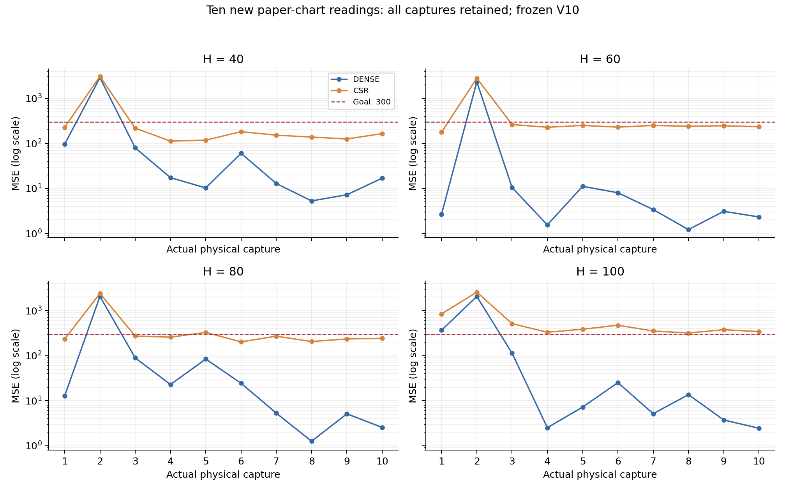
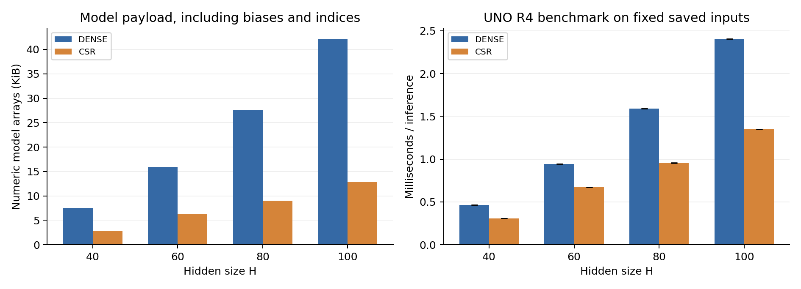

# 概要

Arduino UNO R4 WiFi上で動作する色補正ニューラルネットワークについて、Dense-FP32と枝刈り＋CSRを比較した。隠れ層次元は40・60・80・100とし、実際に紙の3×3チャートを10回読み取り、各回の同じ9入力を全8条件で共有した。学習済み重み・閾値は測定中に変更せず、全10回を集計した。別途、同一の固定入力を用いた実機推論時間とモデル配列容量を測定した。

モデル配列容量は60.51〜69.70%、固定入力での推論時間は28.97〜44.01%削減できた。一方、10回平均MSEはDenseで231.68〜319.56、枝刈り＋CSRで452.04〜651.93となり、全次元で圧縮後の誤差が増加した。したがって、容量・速度の改善を確認したが、今回の閾値での精度維持は達成しなかった。同じ学習チャートの反復読取であり、未見チャートによる独立した最終評価は実施していない。

# 目的

本実験の目的は、色補正ネットワークの重みを枝刈りし、CSR形式へ変換することにより、モデルの格納容量と推論時間がどの程度減少し、その代わりに補正誤差がどの程度増えるかを定量化することである。重みを0にするだけではDense配列の要素数は変わらないため、非ゼロ値と位置情報だけを保持するCSRを組み合わせる。

同じ次元のDenseとCSRに対して同一入力を与え、圧縮による変化を比較する。隠れ層次元だけでなく、精度・容量・速度の3指標を併せて評価する。当初計画は40・50・60次元であったが、実施条件は40・60・80・100次元へ変更した。50次元は実施していない。

# 理論

## ネットワークと学習

構造は3入力、2層の隠れ層、3出力であり、各隠れ層の幅を $H$ とする。隠れ層はReLU、出力層は線形である。

$$
\boldsymbol h_1=\operatorname{ReLU}(W_1\boldsymbol x+\boldsymbol b_1),\quad
\boldsymbol h_2=\operatorname{ReLU}(W_2\boldsymbol h_1+\boldsymbol b_2),\quad
\boldsymbol y=W_3\boldsymbol h_2+\boldsymbol b_3.
$$

3層の重み数は $H^2+6H$、バイアス数は $2H+3$ となる。FP32を4 byteとして、Denseの数値配列容量は

$$ B_{\mathrm{Dense}}=4(H^2+8H+3)\quad[\mathrm{byte}] $$

である。L1正則化は重みの絶対値を小さくする働きを持つ[1]。最終V10では、不安定な入力を含む学習データに対応するため、当初計画のMSE損失から、正の重み付きSmooth L1損失へ変更した。学習データ数 $M=135$、各行の正の重み $a_i$、0〜1の教師値 $t_{i,c}$ に対し、実際に用いた損失は

$$
\mathcal L=\frac{1}{\sum_{i=1}^{M}a_i}
\sum_{i=1}^{M}\frac{a_i}{3}\sum_{c\in\{R,G,B\}}
\ell_\beta(\widehat y_{i,c}-t_{i,c})
+10^{-6}\sum_{\ell=1}^{3}\sum_{j,k}|(W_\ell)_{jk}|,
$$

$$
\ell_\beta(e)=\begin{cases}e^2/(2\beta)&(|e|<\beta),\\|e|-\beta/2&(|e|\geq\beta),\end{cases}\qquad \beta=0.05
$$

である。L1項は平均化しない総和で、バイアスは正則化しない。学習時の連続値の損失と、評価時に整数RGBで求めるMSEを区別する。

## 枝刈りとCSR

重みの大きさによる枝刈り[2]を用い、閾値 $\tau$ に対して $|w|<\tau$ の重みだけを0に置き換える。バイアスは変更しない。3層共通の閾値を使い、重み絶対値の隣接する異なる値の中点を候補とする。候補数を5個などに固定しない。

CSRは非ゼロ値、列番号、各行の開始位置を格納する疎行列形式である[3]。値とバイアスはFP32、列番号はuint8、行ポインタはuint16とした。3層の非ゼロ重み数の合計を $K$ とすると、今回の採用条件の配列容量は

$$ B_{\mathrm{CSR}}=5K+12H+24\quad[\mathrm{byte}],\qquad
S=1-\frac{K}{H^2+6H} $$

となる。$S$ は重みの疎性である。空の層に必要なダミー要素がある場合は追加容量を数えるが、今回の採用モデルでは追加は0 byteだった。

CSRの1層分の計算は、各行についてバイアスから積和を開始し、その行の非ゼロ値だけを順に加算する。CSRの結果は、同じ重みを0化したDense計算とも照合した。

## 評価指標

出力を0〜1へクリップし、255倍して四捨五入する。正解と同じ色順の9画素について、MSEを

$$ \mathrm{MSE}=\frac{1}{27}\sum_{i=1}^{9}\sum_{c\in\{R,G,B\}}(y_{i,c}-t_{i,c})^2 $$

とする。評価用の $y,t$ は0〜255の整数RGBであり、学習損失の尺度とは異なる。各モデルで10回のMSE $m_r$ を求め、平均と標本標準偏差を

$$ \overline m=\frac1{10}\sum_{r=1}^{10}m_r,\qquad
s_m=\sqrt{\frac1{9}\sum_{r=1}^{10}(m_r-\overline m)^2} $$

とする。各回の圧縮前後の差を $d_r=m_{r,\mathrm{CSR}}-m_{r,\mathrm{Dense}}$ とし、対応のある差の平均・標本SDも求める。相対変化は、各回の変化率の平均ではなく、$100(\overline m_{\mathrm{CSR}}/\overline m_{\mathrm{Dense}}-1)$ とした。

容量削減率は $100(1-B_{\mathrm{CSR}}/B_{\mathrm{Dense}})$、推論時間短縮率は $100(1-T_{\mathrm{CSR}}/T_{\mathrm{Dense}})$ とする。追加目標はMSE300以下、精度維持の比較条件はDenseからのMSE増加5%以下とし、両者を別に判定する。

# 実験方法

## 装置と実行環境

| 項目 | 実施条件 |
| --- | --- |
| ボード | Arduino UNO R4 WiFi |
| 主マイコン・クロック | Renesas RA4M1、48 MHz |
| 公称Flash／SRAM | 262,144／32,768 byte |
| センサ | A0へ接続した光センサ。型番は未確認 |
| LED | R:D8、G:D6、B:D7。analogWrite 255／0 |
| 読取設定 | 各チャンネル10サンプル平均、サンプル間2 ms、点灯後10 ms待機 |
| 操作 | シリアル9600 bps。外付けD2/D3ボタンは使わない |
| 利用者のPC | Mac。Pythonの利用環境はJupyter Notebook |
| 最終学習・集計 | クラウドPython 3.12、PyTorch 2.8.0、NumPy 2.3.5 |
| 実機コンパイラ | 7.2.1 20170904、ARM/embedded-7-branch revision 255204 |
| Arduino IDE・コアの版 | 版番号は未記録。実行ログとコンパイラ文字列を保存 |

紙は手で支えて読み取った。照明を同じ状態に保つ手順としたが、照度・距離・角度の定量記録はない。固定具を用いた測定ではなく、この条件は再現性の制約となる。

## 学習データと正解画像

最終学習は、従来の実測135行を全行保持し、入力値を変更せずに行った。内訳は3×3チャートの111行と6×4チャートの24行である。配布Notebookの見本X配列は新しい測定値として加えていない。

正解画像の取り違えが判明したため、最終V10では3×3の111行を先生指定の元の `result.ppm` のRGBへ修正した。正解PPM自体は変更していない。下段中央の灰色は(127,127,127)である。6×4の24行は元のNotebookの教師値を保持しており、別の先生指定PPMとの照合はできていない。以前のCMYK基準のMSEを、今回の基準での改善値へ混ぜない。

各Hの固定V9チェックポイントから初期化し、V10は各Hで1条件のみ、seed42、40,000 epochで追加学習した。Adamの学習率はcosineで0.0005から0.000005へ変化させた。色と校正グループを均す正の行重みを用い、古い測定の整合度に基づく重みを適用した。全行の重みは正で、学習から削除した行はない。

学習時だけ、3×3入力の50%に各チャンネル0.75〜1.30倍のgainと有界offsetを加え、灰・白には30%の確率で0.5〜1.15倍の共通gainを加えた。offset幅は学習入力同士の距離から決めた。正確な設定と各行の重みは同梱コード・CSVへ保存した。

学習へ追加していない保存済み実測9入力を用いてPC・実機再生の照合も行ったが、これは以降の新規10回とは別の記録である。新規10回の入力は学習・閾値選択へ一切加えていない。

## 閾値選択

新規10回の測定前に、各HのV10重みから全候補を作り、別に保存した8×8検証チャート2読取・128入力でMSEを計算した。検証MSEの増加5%以下、CSR容量がDenseより小さい候補を対象とし、さらに学習内のV8の9入力でMSE300以下を満たす候補のうち最小容量を選んだ。この追加条件は当初計画からの変更である。

検証2回目では異なる色が同一の0入力へ潰れる問題が確認されており、閾値の選択は暫定とした。検証128入力で条件を満たすことは、新規10回で精度を維持できる保証にはならない。

| H | 検証Dense MSE | 検証CSR MSE | 変化率 | 学習内V8の9入力CSR MSE |
| --- | ---: | ---: | ---: | ---: |
| 40 | 5012.20 | 4715.84 | -5.91% | 277.52 |
| 60 | 5226.81 | 5292.59 | +1.26% | 260.19 |
| 80 | 5135.44 | 4553.44 | -11.33% | 259.26 |
| 100 | 5237.22 | 4632.38 | -11.55% | 290.37 |

## 紙の新規10回読取

新規読取版 `TEACHER_FRESH_V10` を使用した。各回で黒を当ててb、白を当ててwを送信し、黒白の実測値を登録した。各チャンネルについて $(v-b)/(w-b)$ を0〜1へクリップしてNNへ入力した。

その後、赤・緑・青・黄・水色・紫・黒・灰・白の順に紙を当て直し、各色でrを1回送信した。1色の同じ新規入力を全8モデルに与え、9色終了後に8個のMSEと8枚のPPMを出力した。ログ保存後、nで次の校正・読取へ進み、CAPTURE=1〜10を実施した。1回は9色のチャート読取で、各色の内部10サンプル平均を反復回数として数えない。

全10回のRAW・黒白校正値・正規化入力・モデルハッシュ・閾値・出力PPMを保存した。重み・閾値は途中で変更していない。第2回はMSEが高かったため操作ミスの有無を確認したが、「気づいた操作ミスはない」との回答であり、この回を含む全10回を集計した。除外した回はない。

## 速度と容量の測定

速度は別の `TEACHER_RESULT_COMPARE_V10` で、固定した保存実測9入力を巡回して実機で計時した。各モデルを10回ウォームアップし、100推論を1組として5組計時した。Dense先行とCSR先行を交互に切り替えた。推論と共通のチェックサム加算を含み、センサ読取・シリアル出力・MSE計算を除いた。新規10回の各回で推論時間を計ったわけではない。

配列容量にはFP32重み・バイアス・CSR列番号・行ポインタを含めた。Arduino IDEのFlash・グローバル変数の使用量は、8条件入りプログラム全体の値として別に記録した。

# 結果

## 新規10回のMSE

表1は全10回を含む平均・標本SD・最小値・最大値である。nは各モデル10であり、全8モデルの合計80個のMSEを80回の紙の測定とは数えない。

表1　新規10回の精度。

| H | 方式 | 平均MSE | 標本SD | 最小 | 最大 | 300以下の回数 |
| --- | --- | ---: | ---: | ---: | ---: | ---: |
| 40 | DENSE | 319.56 | 903.46 | 5.30 | 2889.15 | 9/10 |
| 40 | CSR | 452.04 | 923.64 | 112.70 | 3078.33 | 9/10 |
| 60 | DENSE | 238.34 | 738.24 | 1.22 | 2339.37 | 9/10 |
| 60 | CSR | 493.51 | 814.81 | 177.19 | 2811.56 | 9/10 |
| 80 | DENSE | 231.68 | 646.48 | 1.26 | 2069.26 | 9/10 |
| 80 | CSR | 465.73 | 683.36 | 202.44 | 2407.85 | 8/10 |
| 100 | DENSE | 260.43 | 643.69 | 2.44 | 2063.63 | 8/10 |
| 100 | CSR | 651.93 | 694.08 | 318.85 | 2576.07 | 0/10 |

10回平均でMSE300以下だったのはDenseのH60・80・100であった。CSRは全Hで平均300を超え、H100のCSRは各回でも一度も300以下にならなかった。最終第10回だけの低い値を、10回平均へ置き換えてはいない。

図1　各回のMSE。縦軸は対数、破線は利用者目標300である。第2回を含む全点を表示した。

表2　同じ回におけるCSR−Denseの差。

| H | 平均差 | 差の標本SD | 平均MSEの相対増加 |
| --- | ---: | ---: | ---: |
| 40 | 132.48 | 25.44 | +41.46% |
| 60 | 255.17 | 79.34 | +107.06% |
| 80 | 234.05 | 45.73 | +101.02% |
| 100 | 391.50 | 68.45 | +150.33% |

全10回・全HでCSRのMSEはDenseより大きかった。平均MSEの増加率は41.46〜150.33%で、比較条件の5%以内には収まらなかった。

## モデル配列容量

表3　採用した枝刈り閾値と配列容量。

| H | 閾値 | NNZ | 疎性 | Dense byte | CSR byte | 削減率 |
| --- | ---: | ---: | ---: | ---: | ---: | ---: |
| 40 | 0.06084981 | 470 | 74.46% | 7,692 | 2,854 | 62.90% |
| 60 | 0.05434179 | 1141 | 71.19% | 16,332 | 6,449 | 60.51% |
| 80 | 0.04554720 | 1649 | 76.03% | 28,172 | 9,229 | 67.24% |
| 100 | 0.05893202 | 2374 | 77.60% | 43,212 | 13,094 | 69.70% |

CSR索引を含めても、全Hで配列容量が小さくなった。最大削減率はH100の69.70%であり、H40のCSRは全条件中で最小の2,854 byteであった。この削減率はモデル配列の比較値であり、ファームウェア全体のFlashやRAMの削減率ではない。

## 実機推論時間

表4　固定入力での推論時間。単位はµs/推論、±は5組の平均時間の標本SD。

| H | Dense 平均±SD | CSR 平均±SD | 時間短縮率 |
| --- | ---: | ---: | ---: |
| 40 | 465.262 ± 0.0179 | 305.834 ± 0.0913 | 34.27% |
| 60 | 945.648 ± 0.0217 | 671.674 ± 0.0799 | 28.97% |
| 80 | 1593.368 ± 0.0192 | 956.212 ± 0.2984 | 39.99% |
| 100 | 2408.160 ± 0.0158 | 1348.392 ± 0.2527 | 44.01% |

全HでCSRの推論時間が短くなった。時間短縮率は28.97〜44.01%であった。表4のSDは各組100推論の平均を5個比べた値で、表1の紙の10回反復によるMSEのSDとは異なる。

図2　モデル配列容量と実機推論時間。時間の誤差棒は5組の平均時間の標本SDである。計時入力は新規10回とは別の固定9入力である。

## Flash・RAMと動作確認

表5　8条件入りプログラム全体のArduino IDE使用量。

| プログラム | Flash byte | 静的RAM byte | 静的割当後の残りRAM byte |
| --- | ---: | ---: | ---: |
| 保存入力再生・速度版 | 187,888 | 6,740 | 26,028 |
| 新規読取版・全8条件 | 191,320 | 7,324 | 25,444 |

公称容量はFlash262,144 byte、SRAM32,768 byteである。残りRAMはローカル変数が実際に使用した量ではなく、実行時スタックの最大使用量は未測定である。1モデルの隠れ層用配列は固定長float[100]を2本、宣言上800 byteとしたが、これだけで実際の最大スタック使用量を表すことはできない。各条件だけを搭載した単独ビルドのFlash/RAMも測定していない。

全モデルの自己検査とCSR索引検査は保存入力版の実機ログでPASSした。新規10回の全80PPM、計2,160 RGB成分が固定V10のPC再計算と完全一致した。80個のMSEを先生の元の計算HTMLでも照合し、表示桁の範囲で一致した。

# 考察

## 容量・速度と精度のトレードオフ

非ゼロの接続だけを格納・計算したことで、列番号や行ポインタの付加情報を含めても配列容量を削減し、固定入力での推論時間を短縮できた。しかし、今回の閾値では実測入力に対する誤差が増えており、「小さい重みを削れば精度への影響も小さい」という仮説は、そのまま支持されなかった。

検証128入力ではMSEの増加5%以下という選択条件を満たした一方、新規10回では満たさなかった。検証入力の0への潰れ、学習・検証・新しい読取の分布差などにより、閾値選択の結果が測定全体へ一般化しなかった可能性がある。どの要因が支配的かは本実験だけでは特定できない。

## 第2回とばらつき

第2回の全モデルでMSEが大きく、平均と標本SDへ強く影響した。例えばH60のDenseは最小1.22に対して最大2,339.37、平均238.34、標本SD738.24である。このようなデータでは、最良の1回だけで性能を説明できない。

第2回では青・水色などのRAW・正規化入力も他の回から変わっていた。実機出力は同じ入力からのPC出力と一致しており、MSE表示の計算だけを原因とする差ではない。校正・照射・紙の位置・センサ応答などは候補となるが、照度や距離を計測しておらず、原因を断定しない。操作ミスの申告がないため、第2回を外れ値として削除しなかった。

## 次元数と適用範囲

今回の平均値ではDenseのH80が最小MSEだったが、Hを増やすほど良くなる単調な傾向はなかった。また、次元ごとに過去の親チェックポイントも異なり、次元数だけの因果効果とは断定しない。

H40のCSRは最小容量・最短時間、H100のCSRは最大の容量削減率・時間短縮率となったが、いずれも精度維持を同時に達成していない。使用目的によって許容誤差を定め、今回のMSE悪化を含めて判断する必要がある。

## 計画との差分と限界

物理的な10回反復は実施した。一方、未見チャートの独立最終評価、当初計画のH50、各条件単独のFlash/RAM、実行時スタックの最大量は未測定である。紙は手持ちであり、距離・角度・照度を数値で統制していない。測定は同一チャート・同一装置の連続した反復で、統計的に独立な利用環境の標本とまでは主張しない。

学習も当初の33組・MSE損失から、135行・重み付きSmooth L1へ変更した。全学習行での通常の重みなしMSEは付録に示し、10回の再読取結果や学習損失と混ぜない。こうした変更と制約を含めて、本結果は実施した条件内の比較として位置づける。

# 結論

紙の3×3チャートを実際に10回読み取り、40・60・80・100次元のDense／枝刈り＋CSRを同じ入力で比較した。枝刈り＋CSRはモデル配列容量を60.51〜69.70%、固定入力での実機推論時間を28.97〜44.01%削減した。一方、10回平均MSEは全次元で増加し、精度維持およびCSRの平均MSE300以下は達成しなかった。

したがって、今回の条件では容量と速度の改善を確認したが、精度維持を含む目的を全面的に達成したとはいえない。今後は入力の再現性を確認し、評価条件を分けて閾値を決め、独立した未見チャートで精度を検証する必要がある。

# 参考文献

[1] R. Tibshirani, “Regression Shrinkage and Selection via the Lasso,” Journal of the Royal Statistical Society: Series B, 58(1), pp. 267–288, 1996.

[2] S. Han, J. Pool, J. Tran, and W. J. Dally, “Learning Both Weights and Connections for Efficient Neural Networks,” Advances in Neural Information Processing Systems 28, pp. 1135–1143, 2015.

[3] N. Bell and M. Garland, “Implementing Sparse Matrix-Vector Multiplication on Throughput-Oriented Processors,” Proceedings of SC '09, Article 18, pp. 1–11, 2009.

# 付録：各回の実測値と再現資料

## 全10回のDense MSE

| 回 | H40 | H60 | H80 | H100 |
| --- | ---: | ---: | ---: | ---: |
| 1 | 96.037037 | 2.666667 | 12.777778 | 367.185185 |
| 2 | 2889.148148 | 2339.370370 | 2069.259259 | 2063.629630 |
| 3 | 79.851852 | 10.481481 | 89.185185 | 113.518519 |
| 4 | 17.370370 | 1.555556 | 22.888889 | 2.518519 |
| 5 | 10.296296 | 11.185185 | 84.037037 | 7.222222 |
| 6 | 60.555556 | 8.037037 | 24.444444 | 25.222222 |
| 7 | 12.888889 | 3.407407 | 5.296296 | 5.148148 |
| 8 | 5.296296 | 1.222222 | 1.259259 | 13.629630 |
| 9 | 7.259259 | 3.111111 | 5.111111 | 3.740741 |
| 10 | 16.925926 | 2.333333 | 2.555556 | 2.444444 |

## 全10回の枝刈り＋CSR MSE

| 回 | H40 | H60 | H80 | H100 |
| --- | ---: | ---: | ---: | ---: |
| 1 | 228.851852 | 177.185185 | 233.814815 | 846.000000 |
| 2 | 3078.333333 | 2811.555556 | 2407.851852 | 2576.074074 |
| 3 | 217.777778 | 262.888889 | 272.629630 | 513.888889 |
| 4 | 112.703704 | 228.592593 | 257.703704 | 331.370370 |
| 5 | 118.370370 | 251.222222 | 328.444444 | 386.296296 |
| 6 | 182.555556 | 230.074074 | 202.444444 | 474.851852 |
| 7 | 152.555556 | 250.629630 | 271.074074 | 352.703704 |
| 8 | 138.370370 | 241.037037 | 206.037037 | 318.851852 |
| 9 | 125.740741 | 246.518519 | 235.037037 | 377.074074 |
| 10 | 165.148148 | 235.407407 | 242.259259 | 342.185185 |

## 学習135行の重みなしMSE

次の値は学習行を再入力したときの通常の重みなしMSEであり、測定10回のMSEや最小化したSmooth L1損失ではない。不安定な過去の測定も保持したため、大きい値が残っている。

| H | 学習135行のMSE | うち3×3の111行のMSE |
| --- | ---: | ---: |
| 40 | 1794.73 | 1049.10 |
| 60 | 1346.71 | 867.25 |
| 80 | 1151.08 | 764.50 |
| 100 | 922.77 | 495.82 |

## 使用ファイルと再現方法

`code/teacher_fresh_v10/` に実際の新規読取コードと数値ヘッダ、`code/teacher_compare_v10/` に実際の速度比較コードとヘッダを置いた。両者の数値ヘッダは完全一致し、学習データとは別ファイルである。`data/` に集計CSV、`raw_logs/` に元の受領ログ、`source_snapshot/` にV10と必要な補助ソース・親重みを保存した。`manifest.json` に各ファイルのSHA256を記録した。

正解は `reference/result.ppm` で、SHA256は `582b783b099db5bd6fae89ee0355a17f427fb4a4fc3f2750a8acb8398e5383e2` である。学習135行のSHA256は `67385d38c581978bde6bacc2d4571283d0198573939cc8eebc6bea39e6ade73a`、数値ヘッダは `2516a64a3acea49c10a2a26e4c8ffa5f8e1f5092270c7fba0ece0b02b4edcb4e` である。

新規10回は `fresh_readings/capture_01` から `capture_10` の元ログに対応する。保存済み入力の実機再生・速度・使用量は `hardware/run_01` の別記録であり、新規10回へ追加カウントしていない。

再現用コードはPythonによる学習・枝刈り・CSR出力・ログ検算とC++推論コードを含む。新しい紙の読み取り値は同梱ログから再計算できるが、プログラムを実行するだけで新たな物理測定を作ることはできない。ファイル対応と実行手順は同梱のREADMEに記載した。
