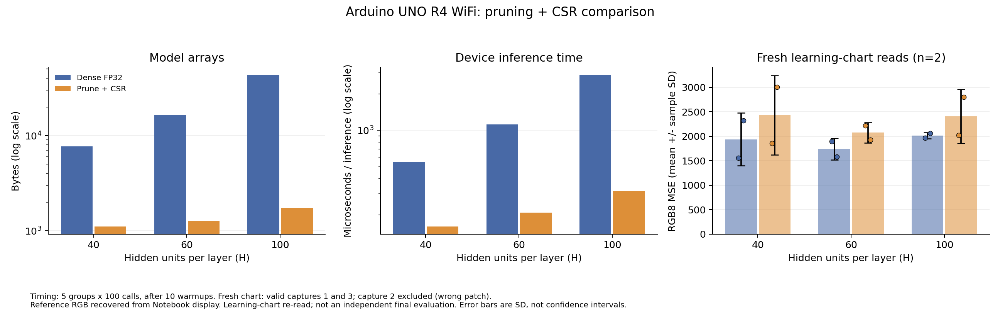

# 受領した実験結果：2026年11月6日

40・60・100次元について、Arduino UNO R4 WiFiでの計算確認と推論時間、モデル配列容量、
学習用3×3を新しく読み直した精度を記録した。
速度は保存済みの入力で測定し、再読取MSEは今回新しくセンサで取得した入力から計算した。

## データ数と除外

有効な紙の読取はCAPTURE=1, 3の2回分、各9色である。
各回で同じ新しい入力を6モデルへ与え、6枚の画像を作った。各条件の物理反復数は2である。
CAPTURE=2は、利用者が違う色を読んだと申告したため操作ミスとして除外した。
除外したログそのものは未受領で、9色を完了したかどうかは未確認である。
番号を繰り上げず、理由を [exclusions.json](fresh_readings/exclusions.json) に残した。

## モデル容量と速度

| H | 配列容量 Dense→CSR [byte] | 容量削減 | 平均時間 Dense→CSR [μs] | Dense/CSR速度比 |
| --- | ---: | ---: | ---: | ---: |
| 40 | 7,692→1,109 | 85.58% | 544.408→160.190 | 3.399倍 |
| 60 | 16,332→1,279 | 92.17% | 1116.416→208.372 | 5.358倍 |
| 100 | 43,212→1,739 | 95.98% | 2865.896→314.110 | 9.124倍 |

10回ウォームアップ後、同じ入力列で100推論を5組測定した。
Dense先行・CSR先行を交互にし、時間にはセンサ読取、待機、MSE計算、シリアル出力を含めない。
5組の生の合計時間、平均、標本標準偏差を原文とJSONに保存した。
CSR索引と固定128入力のDense/CSR出力比較は3次元すべてPASSだった。
配列容量は実配列の合計であり、スケッチ全体のFlash・静的RAM使用量とは異なる。
全6モデル入りの読取スケッチについて、Arduino IDEのコンパイル結果を受領した。

| スケッチ | Flash 使用量 / 上限 [byte] | 静的RAM 使用量 / 上限 [byte] | スタック等に残る領域 [byte] |
| --- | ---: | ---: | ---: |
| fresh_scan_all | 133,424 / 262,144 | 7,268 / 32,768 | 25,500 |

この値は全6モデルを同時に含むスケッチのビルド全体であり、各方式単独の最小使用量ではない。
RAMの使用量はグローバル変数等の静的領域で、ピークRAMは未測定である。
40・60・100各Hの2モデル比較スケッチ単独のFlash・RAMは未記録のまま区別する。
各方式を1つずつ含むビルドの測定用コードは [memory_probe](memory_probe/README.md) に用意した。
その使用量は全6モデル入りの値と区別する。
原文と構造化データは [firmware_memory.csv](firmware_memory.csv) とhardwareフォルダに保存した。

モデル単独の共通ラッパーで受領したビルド使用量は以下で、残りの条件は未記録である。

| 単独条件 | Flash [byte] | 静的RAM [byte] |
| --- | ---: | ---: |
| 40 DENSE | 60,268 | 6,764 |

[single_model_memory.csv](single_model_memory.csv) に別記録として保存した。

## 新たに読み取った学習チャートの精度

MSEは0〜255のRGB整数画像で計算した。表は平均 ± 標本標準偏差（分母n−1）、n=2である。
増加率は各方式の平均MSEの比から求めた。これは各回の増加率を単純平均した値ではない。

| H | Dense MSE | CSR MSE | 平均MSEの増加率 |
| --- | ---: | ---: | ---: |
| 40 | 1938.61 ± 537.43 | 2431.94 ± 812.68 | +25.45% |
| 60 | 1739.19 ± 224.07 | 2074.98 ± 206.87 | +19.31% |
| 100 | 2015.74 ± 63.17 | 2411.54 ± 551.36 | +19.64% |

受領した2回では、全3次元でCSRの平均MSEが増加した。
この学習チャートの再読取結果では、平均MSEの増加5%以内という品質目安を満たさなかった。
一方、閾値を選んだ保存済み検証入力では増加5%以下だった。データの用途を混同しない。
この2回の平均MSEはDense・CSRとも60次元が最小だったが、少ない反復数と学習チャートでの結果であり、
未見チャートで最良の次元だとは判断しない。再読取結果を見て重みや閾値を変更していない。

## 結果から言えることと限界

枝刈り＋CSRによるモデル配列の小型化と推論の高速化を確認した。
今回の新しい読取入力では精度が悪化しており、精度維持まで達成したとは報告しない。
CSRは枝刈り後Denseの参照値と照合しており、保存形式の正しさと枝刈りによる精度変化を分けて扱う。
100次元はDenseとCSRの両方が動作した。モデル配列はconstで、CSRだけが搭載可能だったという結果ではない。

紙は手持ちで、校正値・距離・角度・位置の変動が残る。反復数は2で、有意差や原因の特定は行わない。
参照RGBは元Notebookの保存済み表示から復元した値で、元PNGとの照合は未実施である。
新スキャナの起動時チェック部分のログは未受領だが、受領した新しい全入力についてPC再計算と実機RGB8は完全一致した。
チャートは学習に使った9色なので、独立した最終評価は未実施である。
当初計画のH=50と各条件10回の物理読取は今回の測定に含めていない。

## 精度改善の追加探索（別記録）

上記は元の容量優先候補の測定結果である。
MSE維持を優先する追加探索は [precision_followup](precision_followup/README.md) に分けた。
同じDenseの重みから枝刈りを弱め、学習データ・検証各回・固定入力グリッドで出力の近さを確認する。
追加候補の過去入力によるPC再計算は独立した評価ではなく、新しい実機測定もまだ未受領である。
元の測定値を追加候補の値へ置き換えず、別段階の結果として扱う。
案内後に届いた追加ログは旧版の閾値で動作していたため、[version_mismatch](version_mismatch/README.md) に保存した。
旧版の予定2回の集計と、追加分も含めた旧版の全3ログの参考集計を両方残した。
新スキャナは [precision_scan](precision_followup/precision_scan/README.md) と固有の起動IDで識別し、
vコマンドで今回保存した入力を新モデルへ与える。現時点ではその新しい実機再生結果は未受領である。

## 保存先

- [容量・速度と再読取MSEのCSV](results_summary.csv)
- [比較図PNG](results_overview.png) ／ [図のPDF](results_overview.pdf)
- [実機の速度ログ](hardware/README.md)
- [新しい紙の読取ログとPPM](fresh_readings/README.md)
- [測定方法の変更記録](protocol_change.json)

