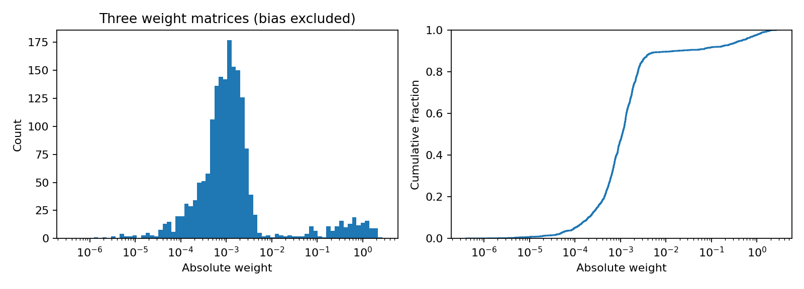
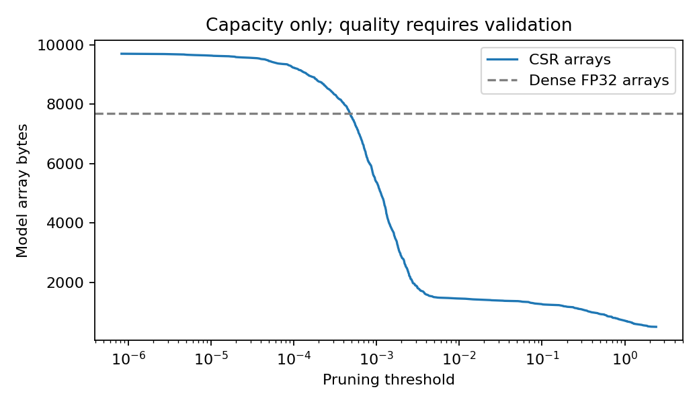

# 閾値選択：最初はH=40の重みを調べる

Jupyter Notebookで `threshold_selection.ipynb` を開き、上から順番に実行します。
`threshold_tools.py` はNotebookと同じフォルダに置いてください。
必要なPythonパッケージはNumPyとMatplotlibです。PyTorchやArduinoの接続は不要です。

最初は `../hdjsk/model_parameters.h` を読み込みます。同じフォルダの
`model_parameters.h` を使うこともできます。Notebook先頭の `HEADER` で確認できます。
元のヘッダやモデルの重みは上書きしません。

## 今できること

- 3層の重みの絶対値のヒストグラムと累積分布を表示します。バイアスは枝刈りしません。
- 隣接する異なる絶対値の中間をすべて候補にし、共通閾値で `abs(w) < threshold` を0にします。
  候補数・閾値を5個などに固定せず、今回は区間をすべて調べます。0は非圧縮の基準です。
- 全候補の非ゼロ数、疎性、CSR配列の理論容量を `results/h40/candidates.csv` に保存します。
- 検証データがない段階では、採用閾値は空欄のままです。容量だけでは選びません。

同梱の `results/h40` は、ユーザー提供の既存H=40ヘッダから作成した容量調査です。
新しく読み取った33組から再学習したモデルではなく、学習時のシードも未確認です。
正式なモデルの重みが決まったら、そのヘッダで再実行してください。
H=50・60も、それぞれの学習済みヘッダを指定して別々に実行します。

今回のH=40では、重み1,840個から1,839候補と基準0を作成しました。
Denseの配列は7,692 byte、枝刈りせずCSR化した場合は索引を含めて9,704 byteです。
CSRをDenseより小さくするには、少なくとも403個（約21.9%）の重みを0にする必要があります。
精度の検証は未実施なので、この容量の結果だけで閾値は確定しません。

## 検証データを用意したら

受け取った検証用の基準画像は `reference/reference_image4.ppm`（8×8、64マス）です。
この画像の色IDと正解RGBは `reference/reference_image4_targets.csv` に保存しています。
読取順は左上から右へ、行を順に進めます。色IDの `r1c1` が左上、`r8c8` が右下です。
読み取り手順は [Arduino側のREADME](../hdjsk/README.md) を参照してください。
正解画像だけではMSEを求められないので、検証用NN入力の実測を待っています。

学習用とは別の検証チャートを独立に3回読み取り、対応する正解RGBと合わせて
`validation.csv` をこのフォルダへ置きます。最終評価チャートは閾値選択に使いません。
データ整形には `validation_template.csv` の列名を使います。空のテンプレートは評価できません。

| 列 | 入れる値 |
| --- | --- |
| `read_id` | 読取回を識別する名前。例：1、2、3。ログを複製せず実際に3回測定します。 |
| `color_id` | チャート上の色位置。同じ位置には3回とも同じIDを付けます。 |
| `input_r/g/b` | ログの「NN入力」。0〜1の値をそのまま使い、255では割りません。 |
| `target_r8/g8/b8` | 検証用の基準画像から得た正解RGB。0〜255の整数です。 |

各回の色数・色位置・正解RGBが一致することを検査します。元の基準画像、チャート識別子、
3回の読取ログ、校正値、測定条件はCSVとともに保存してください。
CSVの数値だけでは学習用・検証用・最終評価用の独立性は確認できないため、用途は利用者が管理します。
同じ入力に異なる正解色が対応する場合は `summary.json` の `input_collisions` に記録します。
今回受け取った学習用ログには4色がすべて0になった箇所があり、校正・測定条件は確認途中です。
そのログを検証データとして流用しません。

CSVを配置したらNotebookの実行セルから再実行します。同じ入力をDenseと全候補へ与え、
Arduinoと同じ順番でFP32の積和、隠れ層ReLU、出力の0〜1クリップ、255倍、四捨五入を行います。
`np.round` の偶数丸めは使用しません。各回のMSEを0〜255尺度で求め、3回の平均を比較します。

採用条件は、Denseに対する平均検証MSEの増加が5%以下、かつCSR容量がDense未満です。
両方を満たす候補のうち容量が最小、同容量ならMSEが小さいものを選びます。
DenseのMSEが0なら候補も0を条件とし、増加率は計算しません。
誤差が閾値に対して単調とは仮定せず、全候補を評価します。

該当する候補がない場合は「採用条件を満たさない」と記録します。
計画書に従う容量最小の診断用候補は別欄に記録し、採用閾値とは区別します。
採用された場合は `selected_csr.npz` にFP32値・バイアス、uint8列番号、uint16行ポインタを保存します。
CSRから元の枝刈り後行列を復元できることと、配列の合計バイト数も確認します。
NPZはPC用の保存形式であり、Arduino用ヘッダの生成・実装確認は次の工程です。

CSR容量は配列データ量です。ビルド全体のRAM・フラッシュ、配置、作業配列、
C++で空配列を実装する場合の保存方法などは、Arduinoへの実装時に別途確認してください。
前処理の校正値・センサ条件も、DenseとCSRでそろえる必要があります。
