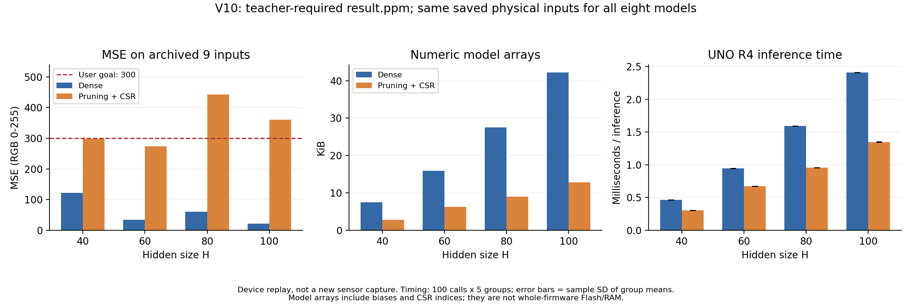

# V10の実機比較結果

2026年11月9日（日本時間）に受領したArduino UNO R4 WiFiのログを保存・検算しました。
40・60・80・100次元のDense／枝刈り＋CSR、全8条件で自己検査・RGB一致検査がPASSし、4組すべての実機速度を取得しました。
先生指定の元の **result.ppm** を正解とし、CMYK版の基準へ変更していません。

**MSEは保存済みの実測9入力を実機で再生した値です。今回は新しい紙の読取ではありません。**
この9入力はV9・V10の学習とV10の枝刈り閾値選択には加えていません。
ただし同じ学習チャートの既に観察した測定を使う追試で、未見チャートによる独立最終評価ではありません。

## 精度・モデル配列容量・実機速度

| H | Dense MSE | CSR MSE | 配列byte Dense→CSR | 配列削減率 | 推論時間µs Dense→CSR | 時間短縮率 |
| --- | ---: | ---: | ---: | ---: | ---: | ---: |
| 40 | 122.44 | 297.22 | 7,692→2,854 | 62.90% | 465.262→305.834 | 34.27% |
| 60 | 33.96 | 273.19 | 16,332→6,449 | 60.51% | 945.648→671.674 | 28.97% |
| 80 | 60.85 | 443.04 | 28,172→9,229 | 67.24% | 1593.368→956.212 | 39.99% |
| 100 | 21.93 | 360.56 | 43,212→13,094 | 69.70% | 2408.160→1348.392 | 44.01% |

Denseは全4モデルで300以下、枝刈り＋CSRはH40・60が300以下です。CSRのH80・100は目標未達です。
**全HでCSRのMSEはDenseより増えています。** この保存9入力で「精度劣化5%以内」を満たした条件はありません。
閾値選択に使った別の検証128入力の条件と、今回の9入力での結果を混同しません。
本結果から容量・時間の削減は確認できますが、精度を維持できたとは結論しません。

例えばH60はMSE33.96→273.19（+239.22、約8.04倍）となる代わりに、配列容量60.51%削減・推論時間28.97%短縮です。
H40のCSRはH60のCSRよりMSEが高くなる一方、今回の中で最小の配列容量・最短の推論時間です。
H80・100の目標未達も結果として残し、同じ評価入力のMSEを見て閾値を選び直しません。

図1　精度・容量・速度の比較。MSEの破線は利用者目標300。速度の誤差棒は5組の平均時間の標本標準偏差です。
[PDF図](figures/device_comparison.pdf) と [集計CSV](device_results.csv) も保存しています。

## 実機速度の条件

入力は同じ保存済み9組を巡回して使用し、10回のウォームアップ後、100推論を5組計時しました。
Dense先行／CSR先行を交互に切り替え、各組の出力チェックサムが凍結済みモデルのPC計算と整合することを確認しました。
計時に推論と共通のチェックサム加算を含め、センサ読取・シリアル出力・MSE計算を含めません。
CPU48MHz、コンパイラ `7.2.1 20170904 (release) [ARM/embedded-7-branch revision 255204]` です。

| H | Dense 平均±標本SD（µs/推論） | CSR 平均±標本SD（µs/推論） |
| --- | ---: | ---: |
| 40 | 465.2620 ± 0.0179 | 305.8340 ± 0.0913 |
| 60 | 945.6480 ± 0.0217 | 671.6740 ± 0.0799 |
| 80 | 1593.3680 ± 0.0192 | 956.2120 ± 0.2984 |
| 100 | 2408.1600 ± 0.0158 | 1348.3920 ± 0.2527 |

このSDは100推論の平均を5組比べた値です。5回の独立した紙の測定でも、個々の推論時間のばらつきでもありません。
旧33入力モデルの実機時間とは異なるモデル・入力なので、旧版の値を今回へ流用していません。

## Flash・RAM

今回のteacher_compare_v10は全8条件入りの比較用プログラムです。

| 項目 | Arduino IDEの表示 |
| --- | ---: |
| スケッチのFlash | 187,888 / 262,144 byte（IDE表示71%） |
| グローバル変数の静的RAM | 6,740 / 32,768 byte（IDE表示20%） |
| 静的割当後に残るRAM | 26,028 byte |

上のFlash/RAMはプログラム全体の値です。個々のDense/CSRモデル単独の使用量ではありません。
残るRAM26,028byteは、ローカル変数が実際に26,028byte使ったという意味ではありません。実行時のスタック使用量は未測定です。
書込ツールの187,896byteは別の値として保存し、スケッチFlash187,888byteと区別します。

## 元データと検算

[受領したシリアルログ](hardware/run_01/submitted_log.txt)、[表示用のバックスラッシュを除いたログ](hardware/run_01/normalized_log.txt)、
[IDE・書込ログ](hardware/run_01/compile_submitted.txt)、[全検算結果](hardware/run_01/summary.json) を保存しました。
重み・学習データ・元のresult.ppm・保存入力のSHA256を照合し、全8PPMの216成分は凍結済みPC出力と完全一致しました。
全8出力のMSEは先生から受領した元のHTMLでも一致しました。速度の平均・標本SD・短縮率を各組の整数µsから再計算しました。
`record_device_run.py` は保存ログから同じ検算・集計を再現します。`make_report.py` がこの表と図を作ります。

各条件のPPM・PNG、[9色RGB一覧](hardware/run_01/rgb9.csv)、[MSE一覧](hardware/run_01/mse.csv)、
[各組の計時値](hardware/run_01/timing_groups.csv) は [run_01](hardware/run_01) にあります。

## 計画から残る項目

新V10の実機再生・速度・全8条件入りFlash/RAMは記録できました。
当初計画の独立した最終評価チャート、10回の物理読取、H50、各条件単独のFlash/RAMは未実施です。
学習全135行の重みなしMSEが300以下だったという結果でもありません。学習全体の値は [学習結果](results.csv) に残しています。
[進捗と制約](remaining_experiments.md) を含めて報告し、当初計画の全項目完了とはしません。
